```mermaid
flowchart TB
  subgraph S1["入口源"]
    LH["listHistoryMessages<br/>GET listHistoryMessages<br/>ChatTurnApi"]
    API["Service 协议 HTTP<br/>completions recover stream respond cancel active"]
    NORM["normalizeChatSseResponse<br/>service chatSseNormalizer"]
  end

  subgraph S2["运行时 Domain 到 UI 唯一入口"]
    subgraph M["runtime/message 消息泵加权威源"]
      PUMP["PumpChatTransport<br/>不发 HTTP 只消费已取流"]
      UC["useChat ai-sdk<br/>解析 append 本地 stop"]
      UM["useChatMessage<br/>messages setMessages pumpSend pumpResume stop"]
      CTM["chatTurnModel<br/>hasRenderableChatContent"]
    end

    subgraph Hist["runtime/history 内聚模块"]
      HFSM["useHistoryLoadingFsm"]
      HDATA["useHistoryData 写 setMessages"]
      UH["useChatHistory<br/>hydrate clear resume loadMore<br/>只消费 isNewSession 布尔"]
    end

    subgraph Conn["runtime/connect"]
      CFSM["useConnectFsm<br/>idle connecting open closed<br/>resolveContinuation"]
      RESUME["useResumeLifecycle<br/>resume 合并 turn 去重 切 session 作废"]
      NEW["runNewStreamConnect<br/>开新 SSE 连接事务"]
    end

    subgraph CTL["runtime/control"]
      UCTL["useChatTurnControl<br/>send cancel cancelling stopConnect"]
    end

    subgraph Appr["runtime/approval"]
      UAP["useChatToolApproval<br/>pending decide submitting"]
      APM["toolApprovalModel"]
    end

    UCR["useChatRuntime<br/>组装根 审批续跑选路仍在此<br/>对外 renderable / isNewSession 入参<br/>不外泄 setMessages 与 SDK 流 API"]
  end

  subgraph S3["Session 域"]
    USC["useChatSessionController<br/>ensureSession<br/>拥有 isNewSession 意图<br/>syncNewSessionHistoryRefresh"]
  end

  subgraph S4["组件消费"]
    CHAT["Chat<br/>直连 useChatRuntime<br/>handleSend 门禁载荷 toast<br/>顶层桥接 session.isNewSession<br/>与 runtime.renderable"]
    HDR["ChatHeader"]
    CONV["ChatConversation<br/>消费 turn 视图"]
    LIST["ChatMessageList"]
    UMUI["UserMessage"]
    AM["AssistantMessage"]
    CIN["ChatInput"]
    BAR["ChatSessionBar"]
    TAD["ToolApprovalDialog"]
  end

  subgraph S5["派生 间接"]
    SSF["StreamingScrollFollower"]
    WSH["WelcomeScreenHost"]
    MHN["MessageHistoryNavigator"]
    SYNC["syncNewSessionHistoryRefresh<br/>消费 runtime.renderable"]
  end

  LH -->|loadPage| HDATA
  API -->|有SSE| NORM
  NORM -->|Response| UCR
  CFSM --> UCR
  RESUME --> UCR
  NEW -->|send与recover| UCTL
  NEW -->|审批recover| UCR
  UCTL --> UCR
  UAP --> UCR
  CTM -->|renderable| UCR
  UCR -->|pumpSend与pumpResume| UM
  PUMP --> UC
  UC --> UM
  HDATA -->|ChatMessagesWriter| UM
  HFSM --> UH
  HDATA --> UH
  UM -->|messages status pump| UCR
  UCR -->|setMessages注入| UH
  USC -->|isNewSession| UCR
  UCR -->|isNewSession| UH

  UCR --> CHAT
  USC -->|ensureSession isNewSession| CHAT
  CHAT -->|onSend| CONV
  CHAT -->|turn视图| CONV
  CHAT --> TAD
  CHAT --> HDR
  CHAT -->|renderable| SYNC
  CONV --> LIST
  CONV --> CIN
  CONV --> BAR
  LIST --> UMUI
  LIST --> AM
  LIST --> SSF
  CONV --> WSH
  LIST --> MHN

  classDef changed fill:#fff3cd,stroke:#e0a800,color:#856404

  class USC,UH,UCR,CTM,CHAT,SYNC changed
```

相对 v9：**会话与 History 用 `isNewSession` 布尔意图解耦**；可渲染判定下沉 Runtime，对外 `renderable`。

## 相对 v9 真实变更

1. **`isNewSession` 意图解耦**：`useChatSessionController` 拥有「本页刚创建」标记，只向 Runtime 声明布尔；History 只消费意图，不再回调清除新建标记。
2. **`chatTurnModel` 迁入** `runtime/message/`：`hasRenderableChatContent` 离开 Chat `_controllers`。
3. **`useChatRuntime` 对外 `renderable`**：由 messages 派生；Chat 顶层用 `runtime.renderable` 调 `syncNewSessionHistoryRefresh`，跨域桥接留在调用点。
4. **Chat `_controllers` 收敛**：只剩 `useChatSessionController`（`chatTurnModel` 已删）。

## 现状结构（相对 v9 变动处）

```
ChatTurn/runtime/
  message/
    chatTurnModel.ts            # hasRenderableChatContent（自 Chat/_controllers 迁入）
    useChatMessage.ts
    pumpChatTransport.ts
  history/
    useChatHistory.ts           # 入参 isNewSession：跳过首载；不回调会话域
  useChatRuntime.ts             # 入参 isNewSession；对外 renderable

Chat/
  index.tsx                     # session.isNewSession → runtime；renderable → sync
  _controllers/
    useChatSessionController.ts # 唯一 Controller；拥有 isNewSession / sync
```

## 边界（现状）

| 层                           | 职责                                                                                            |
| ---------------------------- | ----------------------------------------------------------------------------------------------- |
| **useChatRuntime**           | Domain→UI 唯一入口；入参 `isNewSession`；对外 `renderable` / send / cancel / approval / history |
| **useChatHistory**           | 只消费 `isNewSession` 布尔；hydrate / loadMore；不拥有新建标记                                  |
| **useChatSessionController** | 拥有新建标记与 `isNewSession`；ensureSession；`syncNewSessionHistoryRefresh`                    |
| **Chat**                     | 直连 runtime；发送/取消门禁与 toast；桥接 session↔turn（isNewSession / renderable）             |
| **ChatConversation**         | 纯展示消费 turn 视图                                                                            |

## 新建会话 × History（现状）

```
ensureSession 创建会话
  → session 标记 newChatSessionId
  → isNewSession = true
  → runtime(isNewSession) → history 跳过首载

首个可渲染内容到达
  → runtime.renderable = true
  → Chat effect → session.syncNewSessionHistoryRefresh
  → 侧栏刷新；路由离开该 id 时会话域自行清标记
```

发送 / 取消链路同 v9（Chat 门禁 → `runtime.send` / `runtime.cancel`）。

## 尚未下沉（已知张力）

- `useChatSessionController` 仍在 Chat UI 侧；会话 ensure / 新建意图尚未完全进 ChatSession domain。
- 切会话仍靠长寿命 Runtime 上的 `invalidateResume` / history session 编排；session keyed remount 未落地。
- 审批续跑 DTO 已下沉 Service（`SubmitToolApprovalsCommand` + `mapToolApprovalRequest`）；发送侧 `mapChatTurnRequest` 仍在 control。
- `status` 仍透出 AI SDK `ChatStatus`；业务 `uiBusy` / `localStream` 对外契约未完全替代。

图例：🟡 相对 v9 **真实变更**（isNewSession 解耦；renderable / chatTurnModel 归 Runtime）。

图按**数据流向**自上而下：协议入口 → Runtime 子域组装 → Session 意图注入 → Chat 调用点 → UI。
