```mermaid
flowchart TB
  subgraph S1["入口源"]
    LH["listHistoryMessages<br/>GET listHistoryMessages<br/>ChatTurnApi"]
    API["Service 协议 HTTP<br/>completions recover stream respond cancel active"]
    NORM["normalizeChatSseResponse<br/>service chatSseNormalizer"]
  end

  subgraph S2["运行时 Domain 到 UI 唯一入口"]
    subgraph M["runtime/message 消息泵加权威源"]
      PUMP["PumpChatTransport<br/>不发 HTTP 只消费已取流"]
      UC["useChat ai-sdk<br/>解析 append 本地 stop"]
      UM["useChatMessage<br/>messages setMessages pumpSend pumpResume stop"]
      CTM["chatTurnModel<br/>hasRenderableChatContent"]
    end

    subgraph Hist["runtime/history 内聚模块"]
      HFSM["useHistoryLoadingFsm"]
      HDATA["useHistoryData 写 setMessages"]
      UH["useChatHistory<br/>hydrate clear resume loadMore<br/>只消费 isNewSession 布尔"]
    end

    subgraph Conn["runtime/connect"]
      CFSM["useConnectFsm<br/>idle connecting open closed<br/>resolveContinuation"]
      RESUME["useResumeLifecycle<br/>resume 合并 turn 去重 切 session 作废"]
      NEW["runNewStreamConnect<br/>开新 SSE 连接事务<br/>send 与 recover 共用"]
    end

    subgraph Appr["runtime/approval"]
      UAP["useChatToolApproval<br/>pending decide submitting"]
      APM["toolApprovalModel"]
    end

    UCR["useChatRuntime<br/>组装根<br/>send cancel stopConnect<br/>审批续跑选路<br/>对外 renderable / isNewSession 入参<br/>不外泄 setMessages 与 SDK 流 API"]
  end

  subgraph S3["Session 域"]
    USC["useChatSessionController<br/>ensureSession<br/>拥有 isNewSession 意图<br/>syncNewSessionHistoryRefresh"]
  end

  subgraph S4["组件消费"]
    CHAT["Chat<br/>直连 useChatRuntime<br/>handleSend 门禁载荷 toast<br/>顶层桥接 session.isNewSession<br/>与 runtime.renderable"]
    HDR["ChatHeader"]
    CONV["ChatConversation<br/>消费 turn 视图"]
    LIST["ChatMessageList"]
    UMUI["UserMessage"]
    AM["AssistantMessage"]
    CIN["ChatInput"]
    BAR["ChatSessionBar"]
    TAD["ToolApprovalDialog"]
  end

  subgraph S5["派生 间接"]
    SSF["StreamingScrollFollower"]
    WSH["WelcomeScreenHost"]
    MHN["MessageHistoryNavigator"]
    SYNC["syncNewSessionHistoryRefresh<br/>消费 runtime.renderable"]
  end

  LH -->|loadPage| HDATA
  API -->|有SSE| NORM
  NORM -->|Response| UCR
  CFSM --> UCR
  RESUME --> UCR
  NEW -->|send与recover| UCR
  UAP --> UCR
  CTM -->|renderable| UCR
  UCR -->|pumpSend与pumpResume| UM
  PUMP --> UC
  UC --> UM
  HDATA -->|ChatMessagesWriter| UM
  HFSM --> UH
  HDATA --> UH
  UM -->|messages status pump| UCR
  UCR -->|setMessages注入| UH
  USC -->|isNewSession| UCR
  UCR -->|isNewSession| UH

  UCR --> CHAT
  USC -->|ensureSession isNewSession| CHAT
  CHAT -->|onSend| CONV
  CHAT -->|turn视图| CONV
  CHAT --> TAD
  CHAT --> HDR
  CHAT -->|renderable| SYNC
  CONV --> LIST
  CONV --> CIN
  CONV --> BAR
  LIST --> UMUI
  LIST --> AM
  LIST --> SSF
  CONV --> WSH
  LIST --> MHN

  classDef changed fill:#fff3cd,stroke:#e0a800,color:#856404
  classDef removed fill:#f8d7da,stroke:#c82333,color:#721c24

  class UCR,NEW changed
```

相对 v10：**拆除 `runtime/control`**。`send` / `cancel` / `stopConnect` / `cancelling` 收回 `useChatRuntime`；与审批 `recover` 平行共用 `runNewStreamConnect`。

## 相对 v10 真实变更

1. **删除** `runtime/control/useChatTurnControl.ts`（整目录移除）。
2. **`useChatRuntime`**：内联用户回合动作；组装根同时编排 send/cancel 与审批续跑选路。
3. **发送 DTO**：`mapChatTurnRequest` 调用点随 send 迁入 Runtime（仍未下沉 Service；见张力）。

## 现状结构（相对 v10 变动处）

```
ChatTurn/runtime/
  connect/
    runNewStreamConnect.ts      # send 与 recover 共用开流事务
  approval/
  history/
  message/
  useChatRuntime.ts             # 无 control 子域；直接持有 send/cancel
  # control/ 已删除
```

## 边界（现状）

| 层                           | 职责                                                                                         |
| ---------------------------- | -------------------------------------------------------------------------------------------- |
| **useChatRuntime**           | Domain→UI 唯一入口；send/cancel/stopConnect；审批续跑选路；`renderable` / history / approval |
| **runNewStreamConnect**      | 开新 SSE 连接事务；被 send 与 recover 平行调用                                               |
| **useChatHistory**           | 只消费 `isNewSession` 布尔；hydrate / loadMore                                               |
| **useChatSessionController** | 拥有新建标记与 `isNewSession`；ensureSession；`syncNewSessionHistoryRefresh`                 |
| **Chat**                     | 直连 runtime；发送/取消门禁与 toast；桥接 session↔turn                                       |

## 发送 / 审批开流（现状）

```
Chat.handleSend → runtime.send
  → mapChatTurnRequest → runNewStreamConnect → streamChatCompletion → pumpSend

runtime.submitToolApprovals
  → respond | respond+resume | runNewStreamConnect(recover) → pumpSend
```

两条开流路径平行，不再经中间 control 壳。

## 尚未下沉（已知张力）

- `useChatSessionController` 仍在 Chat UI 侧；会话 ensure / 新建意图尚未完全进 ChatSession domain。
- 切会话仍靠长寿命 Runtime 上的 `invalidateResume` / history session 编排；session keyed remount 未落地。
- 发送侧 `mapChatTurnRequest` 仍在 Runtime；审批 DTO 已在 Service（`SubmitToolApprovalsCommand`）。
- `status` 仍透出 AI SDK `ChatStatus`；业务 `uiBusy` / `localStream` 对外契约未完全替代。

图例：🟡 相对 v10 **真实变更**（拆除 control；send/cancel 归组装根）。

图按**数据流向**自上而下：协议入口 → Runtime 子域组装 → Session 意图注入 → Chat 调用点 → UI。
