```mermaid
flowchart TB
  subgraph S1["入口源"]
    LH["listHistoryMessages<br/>GET listHistoryMessages<br/>ChatTurnApi"]
    API["Service 协议 HTTP<br/>completions recover stream respond cancel active"]
    NORM["normalizeChatSseResponse<br/>service chatSseNormalizer"]
  end

  subgraph S2["运行时 Domain 到 UI 唯一入口"]
    subgraph M["runtime/message 消息泵加权威源"]
      PUMP["PumpChatTransport<br/>不发 HTTP 只消费已取流"]
      UC["useChat ai-sdk<br/>解析 append 本地 stop"]
      UM["useChatMessage<br/>messages setMessages pumpSend pumpResume stop"]
      CTM["chatTurnModel<br/>hasRenderableChatContent"]
    end

    subgraph Hist["runtime/history 内聚模块"]
      HFSM["useHistoryLoadingFsm"]
      HDATA["useHistoryData 写 setMessages"]
      UH["useChatHistory<br/>hydrate clear resume loadMore<br/>只消费 isNewSession 布尔"]
    end

    subgraph Conn["runtime/connect 本地流生命周期"]
      CFSM["useConnectFsm<br/>idle connecting open closed<br/>resolveContinuation"]
      RESUME["useConnectResume<br/>resume 合并 turn 去重 切 session 作废"]
      NEW["runNewStreamConnect<br/>开新 SSE 连接事务"]
      ACT["useConnectActions<br/>send cancel stopConnect cancelling"]
    end

    subgraph Appr["runtime/approval"]
      UAP["useChatToolApproval<br/>pending decide submitting"]
      APM["toolApprovalModel"]
    end

    UCR["useChatRuntime<br/>组装根 审批续跑选路<br/>对外 renderable / isNewSession 入参<br/>不外泄 setMessages 与 SDK 流 API"]
  end

  subgraph S3["Session 域"]
    USC["useChatSessionController<br/>ensureSession<br/>拥有 isNewSession 意图<br/>syncNewSessionHistoryRefresh"]
  end

  subgraph S4["组件消费"]
    CHAT["Chat<br/>直连 useChatRuntime<br/>handleSend 门禁载荷 toast<br/>顶层桥接 session.isNewSession<br/>与 runtime.renderable"]
    HDR["ChatHeader"]
    CONV["ChatConversation<br/>消费 turn 视图"]
    LIST["ChatMessageList"]
    UMUI["UserMessage"]
    AM["AssistantMessage"]
    CIN["ChatInput"]
    BAR["ChatSessionBar"]
    TAD["ToolApprovalDialog"]
  end

  subgraph S5["派生 间接"]
    SSF["StreamingScrollFollower"]
    WSH["WelcomeScreenHost"]
    MHN["MessageHistoryNavigator"]
    SYNC["syncNewSessionHistoryRefresh<br/>消费 runtime.renderable"]
  end

  LH -->|loadPage| HDATA
  API -->|有SSE| NORM
  NORM -->|Response| UCR
  CFSM --> UCR
  RESUME --> UCR
  ACT --> UCR
  NEW -->|send| ACT
  NEW -->|审批recover| UCR
  UAP --> UCR
  CTM -->|renderable| UCR
  UCR -->|pumpSend与pumpResume| UM
  PUMP --> UC
  UC --> UM
  HDATA -->|ChatMessagesWriter| UM
  HFSM --> UH
  HDATA --> UH
  UM -->|messages status pump| UCR
  UCR -->|setMessages注入| UH
  USC -->|isNewSession| UCR
  UCR -->|isNewSession| UH

  UCR --> CHAT
  USC -->|ensureSession isNewSession| CHAT
  CHAT -->|onSend| CONV
  CHAT -->|turn视图| CONV
  CHAT --> TAD
  CHAT --> HDR
  CHAT -->|renderable| SYNC
  CONV --> LIST
  CONV --> CIN
  CONV --> BAR
  LIST --> UMUI
  LIST --> AM
  LIST --> SSF
  CONV --> WSH
  LIST --> MHN

  classDef changed fill:#fff3cd,stroke:#e0a800,color:#856404

  class Conn,ACT,NEW,UCR changed
```

相对 v11：`send` / `cancel` / `stopConnect` **归入 connect**（`useConnectActions`），承认它们是本地流开停动作，不是独立业务 control 层。

## 相对 v11 真实变更

1. **新增** `runtime/connect/useConnectActions.ts`：send / cancel / stopConnect / cancelling。
2. **`useChatRuntime`**：不再内联开停流；只组装 connect 动作，并保留审批续跑选路（含 recover 直调 `runNewStreamConnect`）。

## 现状结构（相对 v11 变动处）

```
ChatTurn/runtime/connect/
  useConnectFsm.ts
  useConnectResume.ts
  runNewStreamConnect.ts          # send 与 recover 共用
  useConnectActions.ts            # send / cancel / stopConnect
```

## 边界（现状）

| 层                     | 职责                                                       |
| ---------------------- | ---------------------------------------------------------- |
| **connect**            | 相位 FSM、resume 生命周期、开流事务、用户 send/cancel/stop |
| **useChatRuntime**     | 组装；审批续跑选路（respond / resume / recover）           |
| **approval / history** | 同 v11                                                     |

## 尚未下沉（已知张力）

- 审批 recover 仍在 Runtime 直调 `runNewStreamConnect`（选路在组装根；开流事务在 connect）。
- 发送侧 `mapChatTurnRequest` 仍在 `useConnectActions`；审批 DTO 已在 Service。
- SessionController / session keyed remount / SDK `status` 同前。

图例：🟡 相对 v11 **真实变更**（send/cancel 进 connect）。
