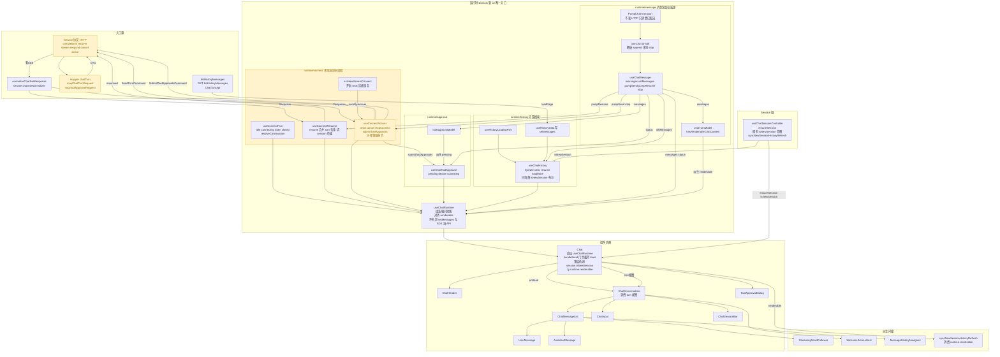

相对 v13：发送侧 completion DTO 映射**归入 Service**（`SendTurnCommand` + `mapChatTurnRequest`）；connect 的 send 与审批续跑对称，只传领域意图。

## 相对 v13 真实变更

1. **新增** `SendTurnCommand`：`sessionId` / `model` / `query` / `options`。
2. **`IChatTurnService.streamChatCompletion`**：入参由 `ChatCompletionApiRequest` 改为 `SendTurnCommand`；实现内调 `mapChatTurnRequest`。
3. **`useConnectActions.send`**：删除对 `mapChatTurnRequest` 的直接调用；只组 `SendTurnCommand`。本地乐观气泡仍用 `mapUserMessageMetadata`（非 wire DTO）。

## 现状结构（相对 v13 变动处）

```
ChatTurn/service/
  index.type.ts                 # + SendTurnCommand；streamChatCompletion 改领域命令
  ChatTurnServices.impl.ts      # mapChatTurnRequest 下沉到 Service

ChatTurn/runtime/connect/
  useConnectActions.ts          # send 只传 SendTurnCommand；不再碰 completion wire DTO
```

## 边界（现状）

| 层                 | 职责                                                                 |
| ------------------ | -------------------------------------------------------------------- |
| **Service**        | 发送 / 审批 wire DTO 组装；SSE 归一化；协议 HTTP                     |
| **connect**        | 相位 FSM、resume、开流事务、send/cancel/stop、审批续跑选路；只传意图 |
| **useChatRuntime** | 组装接线；不内联开停流与审批选路                                     |
| **approval**       | 扫 pending → decide → 交 `submitToolApprovals`；不碰连接编排         |
| **history**        | 同 v13                                                               |

## 发送 / 审批（对称后）

```
Chat.handleSend → runtime.send
  → SendTurnCommand → Service.mapChatTurnRequest → stream → pumpSend

runtime.submitToolApprovals
  → SubmitToolApprovalsCommand → Service.mapToolApprovalRequest
  → respond | respond+resume | recover → pumpSend
```

## 已知张力（未改）

- 本地乐观 user metadata（`mapUserMessageMetadata`）仍在 connect 调用；属 UI 泵载荷，非 wire。
- SessionController / session keyed remount / SDK `status` 同前。

图例：🟡 相对 v13 **真实变更**（发送 DTO 进 Service）。

图约定：S2 内 `message` → history / connect / approval / 组装根 为**能力供给**；`isNewSession` 为 Session → History 意图（组装根只接线，不拥有）；子域 → `useChatRuntime` 为组装接线。自上而下：协议入口 → Runtime 子域 → Session 意图 → Chat → UI。
