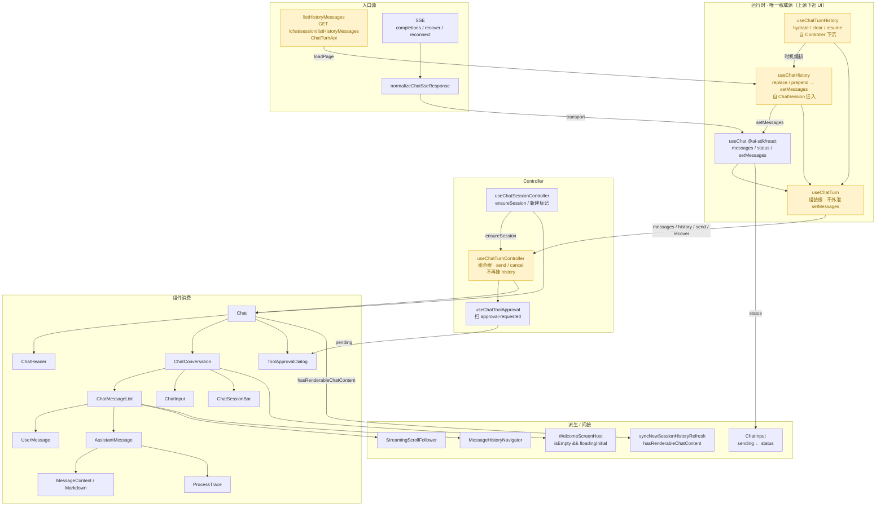

对照 commit：`a68e7559`（相对 `d47fc39f`）。

图例：🟡 相对 v1 **真实变更**（迁移 / 职责调整）。无独立新增模块；Session/Header/Bar/Input/normalizer 在 v1 基线已存在，仅旧图漏画，故不标绿。移动只标黄，不再另画红块。

图按**数据流向**自上而下：入口源 → messages 权威源 → Runtime 组装 → Controller → UI。
