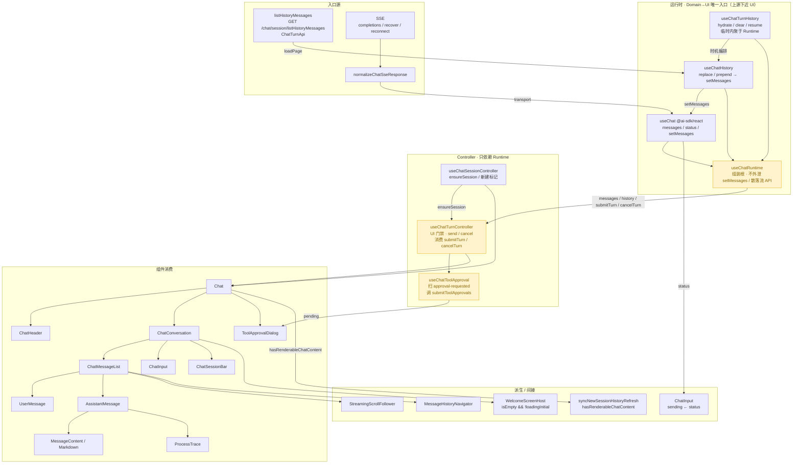

相对 v2：Domain 公开入口由 `useChatTurn` 收敛为 `useChatRuntime`。

边界：Controller / UI 只通过 `useChatRuntime` 消费 ChatTurn 业务能力；`setMessages`、散落流 API、recover body 组装不泄漏到 UI。`history` 分页态暂由 Runtime 返回，目标归属 UI/Controller。

图例：🟡 相对 v2 **真实变更**（公开入口与 Controller 消费契约）。Turn 仍为控制面领域词；UI 入口不再叫 Turn。

图按**数据流向**自上而下：入口源 → messages 权威源 → Runtime 组装 → Controller → UI。
