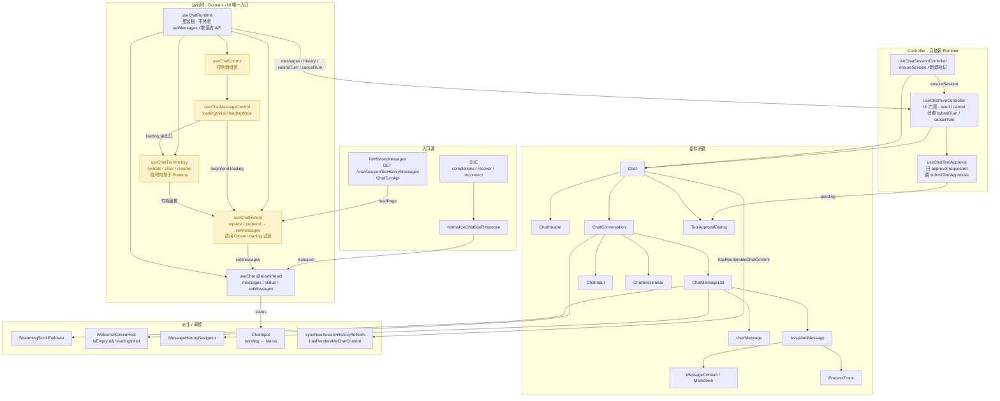

相对 v3：Runtime 内新增 `useChatControl` → `useChatMessageControl`；`loadingInitial` / `loadingMore` 归属 Control，数据面 `useChatHistory` 只通过过渡方法驱动。切会话编排仍临时在 `useChatTurnHistory`。

边界：Controller / UI 契约不变，仍只通过 `useChatRuntime` 消费；`history.loading*` 对外形状保持。

图例：🟡 相对 v3 **真实变更**（control 层与 loading 归属）。
