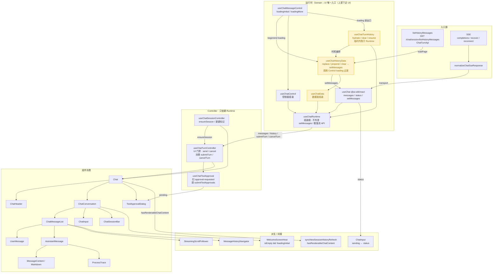

相对 v4：Runtime 内新增 `useChatData` → `useChatHistoryData`（原 `useChatHistory` 迁入 `runtime/data` 并更名）；`replace` / `prepend` / `clear` 归属 Data，仍只通过 Control 过渡方法驱动 loading。切会话编排仍临时在 `useChatTurnHistory`。

边界：Controller / UI 契约不变，仍只通过 `useChatRuntime` 消费；`history` 对外形状保持（`canLoadMore` / `loadMore` / `loading*`）。

图例：🟡 相对 v4 **真实变更**（data 层与 history 数据面归属）。

图按**数据流向**自上而下：入口源 → messages 权威源 → Runtime 组装 → Controller → UI。
