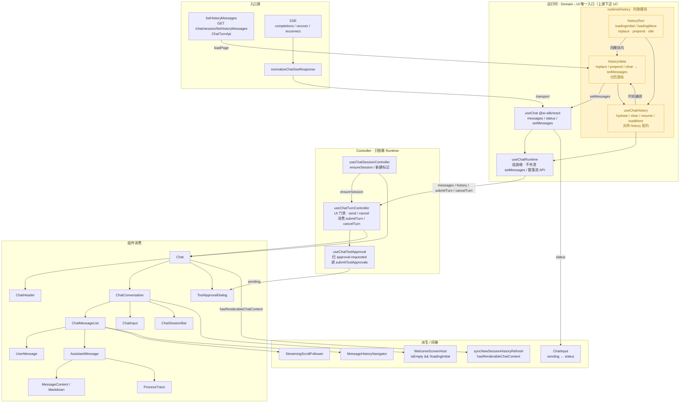

相对 v5：**撤回** Runtime 顶层 `control` / `data` 横切拆分。History 的 loading 状态与分页写入天然同事务，拆成互注平面只会把依赖推回组装根。

目标结构：

```
runtime/history/
  useChatHistory.ts     # 对外 facade：hydrate / clear / resume / loadMore + 对外形状
  fsm/                  # loading 相位机（原 message control）
  data/                 # 分页游标与 setMessages 写入（原 history data）
```

迁移动作（相对当前代码）：

| 现位置                                  | 目标                                  |
| --------------------------------------- | ------------------------------------- |
| `runtime/control/useChatMessageControl` | `runtime/history/fsm`                 |
| `runtime/data/useChatHistoryData`       | `runtime/history/data`                |
| `runtime/useChatTurnHistory`            | 并入 `runtime/history/useChatHistory` |
| `useChatControl` / `useChatData` 空壳   | 删除；不再作为 Runtime 一级平面       |

边界：Controller / UI 契约不变，仍只通过 `useChatRuntime` 消费；`history` 对外形状保持（`canLoadMore` / `loadMore` / `loading*`）。fsm 与 data 只在 `history` 模块内互引，**不**经 Runtime 交叉注入。

图例：🟡 相对 v5 **真实变更**（history 内聚；取消顶层 control/data）。

图按**数据流向**自上而下：入口源 → messages 权威源 → Runtime 组装 → Controller → UI。
