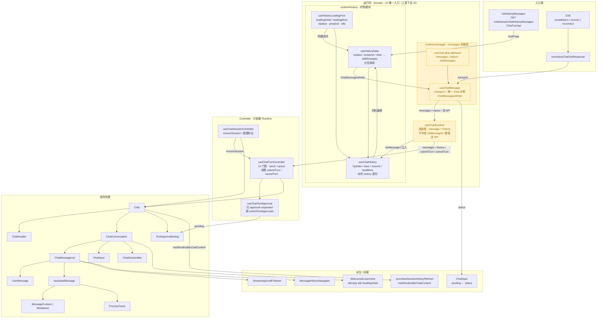

相对 v6：把唯一 `useChat` 从 Runtime 组装根**下沉**到 `runtime/message`。History 仍只经写端口改列表；组装根负责一次接线，避免 History 自行 `useChatMessage()` 造成双实例。

目标结构：

```
runtime/message/
  useChatMessage.ts     # transport + 唯一 useChat；对外 ChatMessagesWriter / 流 API / messages 视图

runtime/history/
  useChatHistory.ts     # 对外 facade：hydrate / clear / resume / loadMore + 对外形状
  useHistoryLoadingFsm.ts
  useHistoryData.ts     # 分页游标；经 ChatMessagesWriter 写入权威源

runtime/useChatRuntime.ts   # 组装根：message + history + submit/recover/resume 映射
```

迁移动作（相对 v6 / 当时代码）：

| 现位置                                                 | 目标                                                                            |
| ------------------------------------------------------ | ------------------------------------------------------------------------------- |
| `useChatRuntime` 内 `useChat` + `DefaultChatTransport` | `runtime/message/useChatMessage`                                                |
| History 选项里内联的 `setMessages` 类型                | `ChatMessagesWriter`（由 message 模块定义）                                     |
| Runtime → History 注入                                 | `setMessages: message.setMessages`（单向；History **不**反向持有 message hook） |
| `runtime/control/*`、`runtime/data/*` 空壳             | 删除（v6 已规划、仍待清）                                                       |

边界：

- Controller / UI 契约不变，仍只通过 `useChatRuntime` 消费。
- `history` 对外形状保持（`canLoadMore` / `loadMore` / `loading*`）。
- `message` 与 `history` **不**互注：只经 Runtime 把 `ChatMessagesWriter` 注入 History。
- merge / 分页游标留在 `history`；流式增量与 `sendMessage` / `resumeStream` / `stop` 留在 `message`（Runtime 做 turn 级映射与去重）。

图例：🟡 相对 v6 **真实变更**（message 下沉；Runtime 变薄组装根）。

图按**数据流向**自上而下：入口源 → messages 权威源（message）→ Runtime 组装 → Controller → UI。
