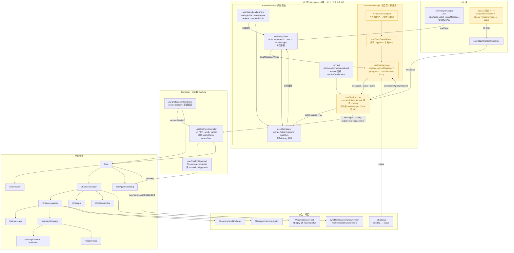

相对 v6：把唯一 `useChat` 从 Runtime 组装根**下沉**到 `runtime/message`，并切断协议与泵：

- **Service**：completions / recover / stream / respond / cancel / active（协议 HTTP；SSE 经 normalize）。
- **Runtime**：业务语义调度（如打开对话 → 查 active → reconnect → pump）。
- **useChatMessage**：只暴露 `pumpSend` / `pumpResume` / `messages` / `setMessages` / `stop`；**不**外泄 `sendMessage` / `resumeStream`，**不**做 endpoint 选路。

目标结构：

```
runtime/connect/
  useConnectFsm.ts          # idle | connecting | open | closed；内含 resolveContinuation
  useResumeLifecycle.ts     # resume 合并 / turn 去重 / 切 session 作废

runtime/message/
  pumpChatTransport.ts  # 不发 HTTP；arm 已取 SSE body
  useChatMessage.ts     # 唯一 useChat；对外泵 + 数据面

runtime/history/
  useChatHistory.ts
  useHistoryLoadingFsm.ts
  useHistoryData.ts

runtime/useChatRuntime.ts   # connect FSM 调度 + Service 取流 → pump
```

边界：

- 上层给业务意图 → Runtime 用 **connect FSM** + active 选路径 → Service 打对应接口 → **仅当有新 SSE 时** `pump*`。
- resume 也是一种 connect；FSM 描述连接生命周期，不叫 localStream。
- `useConnectFsm.resolveContinuation`：live → respond；idle/closed + active → respond+resume；否则 recover。
- `respond` 不经泵；`cancel` = `stopConnect`（closed）+ 后端 cancel。
- Controller / UI 仍只通过 `useChatRuntime` 消费。
- History 经 `ChatMessagesWriter` 写入同一权威源；不持有 message hook。

图例：🟡 相对 v6 **真实变更**（message 下沉 + 协议/泵分离）。

图按**数据流向**自上而下：协议入口 → 泵（message）→ Runtime 组装 → Controller → UI。
