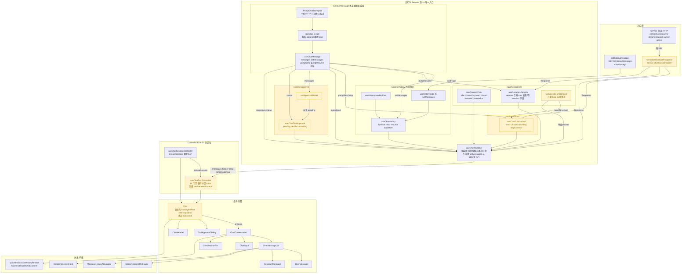

相对 v7：**审批与回合控制进 Runtime 子域**；消息实体归 ChatTurn；Controller 变薄但仍包一层 UI 门禁。

## 相对 v7 真实变更

1. **`runtime/approval`**：原 Chat `_controllers/useChatToolApproval` 迁入；`useChatRuntime` 组装后对外 `approval`；Controller 只透传。
2. **`runtime/control`**：协议级 `send` / `cancel` / `cancelling` / `stopConnect` 从组装根内联抽出；对外不再叫 `submitTurn` / `cancelTurn`。
3. **`runtime/connect/runNewStreamConnect`**：开新 SSE 的连接事务；`control.send` 与审批 `recover` **各自直接调用**，不经 control 外泄助手。
4. **Mapper**：`mapOutgoingUserMessageMetadata` 承接乐观 user 气泡附件快照；不再堆在 control 里。
5. **Entity**：`WisePenUIMessage` / `ChatMessageMetadata` 等落在 `ChatTurn/entity/message.ts`。
6. **SSE normalize**：`service/chatSseNormalizer`（Service 取流后规范化）。

## 现状结构

```
ChatTurn/
  entity/message.ts
  mapper/
    chatTurn.mapper.ts          # mapChatTurnRequest + mapOutgoingUserMessageMetadata
    chatHistory.mapper.ts
  service/
    chatSseNormalizer.ts
    ChatTurnServices.impl.ts
  runtime/
    connect/
      useConnectFsm.ts
      useResumeLifecycle.ts
      runNewStreamConnect.ts
    message/
      pumpChatTransport.ts
      useChatMessage.ts
    history/
      useChatHistory.ts
      useHistoryLoadingFsm.ts
      useHistoryData.ts
    control/
      useChatTurnControl.ts     # 协议 send/cancel；无 UI 门禁
    approval/
      useChatToolApproval.ts
      toolApprovalModel.ts
    useChatRuntime.ts           # 组装 + 审批续跑选路（respond / resume / recover）
```

## 边界（现状）

| 层                        | 职责                                                                                                        |
| ------------------------- | ----------------------------------------------------------------------------------------------------------- |
| **Service**               | completions / recover / stream / respond / cancel / active；SSE 经 normalize                                |
| **connect**               | 连接相位；resume 生命周期；`runNewStreamConnect` 新开流事务                                                 |
| **message**               | 唯一 `useChat`；`pump*` / messages 权威源                                                                   |
| **history**               | hydrate / loadMore；经 `ChatMessagesWriter` 写入同一权威源                                                  |
| **control**               | 协议 `send`（已有 sessionId + 载荷）/ `cancel`（stopConnect + 后端 cancel）                                 |
| **approval**              | 扫 `approval-requested`；决定收敛后调组装根 `submitToolApprovals`                                           |
| **useChatRuntime**        | 组装上述子域；审批续跑用 connect + active 选路                                                              |
| **useChatTurnController** | 仍在：登录后资源门禁、`ensureSession`、frontendStates / 附件载荷拼装、toast；再调 `runtime.send` / `cancel` |
| **Chat**                  | 再包一层：登录、`hostAgentPort.interceptSend`、路由 locationKey 失效丢弃，再调 `turn.send`                  |

## 发送链路（现状，两层门禁）

```
ChatInput.onSend
  → Chat.handleSend          # 登录 + host intercept
  → turn.send（Controller）  # 资源门禁 / ensureSession / 载荷 / toast
  → runtime.send（control）  # map 请求 + runNewStreamConnect + pumpSend
```

`cancel` 类似：Controller 包 toast → `runtime.cancel`（cancelling 互斥 + stopConnect + Service cancel）。

## 尚未下沉（已知张力）

- `useChatTurnController` 仍是 Chat 与 Runtime 之间的 UI 编排壳；`ChatConversation` 的 `turn` props 仍绑 Controller 结果类型。
- 发送门禁 / toast / `currentModel` / `hasRenderableChatContent` 仍在 Controller；与「调用点直接消费 runtime」尚未对齐。
- 切会话仍靠长寿命 Runtime 上的 `invalidateResume` / history session 编排；session keyed remount 未落地。

图例：🟡 相对 v7 **真实变更**（approval / control / runNewStreamConnect / entity·normalize 归位；Controller 变薄但未消失）。

图约定：S2 内 `message` → history / connect / approval / 组装根 为**能力供给**（setMessages / pump* / messages·status）；子域 → `useChatRuntime` 为组装接线；组装根不拥有、不「注入」这些端口。自上而下：协议入口 → Runtime 子域 → Controller → Chat UI。
