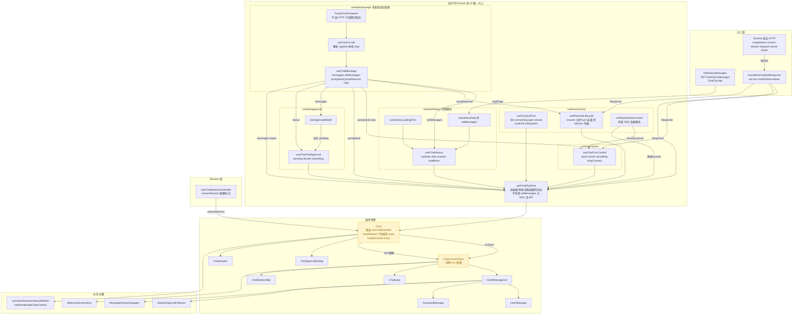

相对 v8：**拆掉 `useChatTurnController`**。Chat 直连 `useChatRuntime`；发送门禁、载荷拼装与 toast 落在调用点；Conversation 只吃 turn 视图。

## 相对 v8 真实变更

1. **删除** `Chat/_controllers/useChatTurnController.ts`。
2. **`Chat/index.tsx`**：直接 `useChatRuntime`；`handleSend` 合并原 Chat 登录/host intercept 与原 Controller 资源门禁/`ensureSession`/载荷/toast；`handleCancel` 包 cancel toast。
3. **`ChatConversationTurn`**：Conversation 的 `turn` props 改为 runtime 数据面 + 调用点维护的 `cancel` / `currentModel` / `isEmpty`，不再绑 Controller 结果类型。

## 现状结构（Chat 侧）

```
Chat/
  index.tsx                         # 直连 runtime；handleSend / handleCancel
  ChatConversation/index.type.ts    # ChatConversationTurn 视图
  _controllers/
    useChatSessionController.ts     # 仍在（会话域）
    chatTurnModel.ts                # hasRenderableChatContent
```

Runtime 子域结构同 v8（message / history / connect / control / approval）。

## 边界（现状）

| 层                           | 职责                                                                             |
| ---------------------------- | -------------------------------------------------------------------------------- |
| **useChatRuntime**           | Domain→UI 唯一入口；组装 control / approval / history / message / connect        |
| **Chat**                     | 直连 runtime；发送/取消处维护门禁与 toast；拼 Conversation turn 视图与审批对话框 |
| **ChatConversation**         | 纯展示消费：messages / history / status / cancel / currentModel                  |
| **useChatSessionController** | ensureSession / 新建标记 / 会话栏 UI 态                                          |

## 发送链路（现状）

```
ChatInput.onSend
  → Chat.handleSend     # 登录 + host intercept + 资源门禁 + ensureSession + 载荷 + toast
  → runtime.send        # map 请求 + runNewStreamConnect + pumpSend
```

`cancel`：`Chat.handleCancel`（toast）→ `runtime.cancel`。

## 尚未下沉（已知张力）

- `useChatSessionController` 仍在 Chat UI 侧；会话 ensure / 新建标记尚未完全进 ChatSession domain。
- 切会话仍靠长寿命 Runtime 上的 `invalidateResume` / history session 编排；session keyed remount 未落地。

图例：🟡 相对 v8 **真实变更**（拆 TurnController；Chat 直连 runtime）。

图约定：S2 内 `message` → history / connect / approval / 组装根 为**能力供给**（setMessages / pump* / messages·status）；子域 → `useChatRuntime` 为组装接线；组装根不拥有、不「注入」这些端口。自上而下：协议入口 → Runtime 子域 → Chat → UI。
