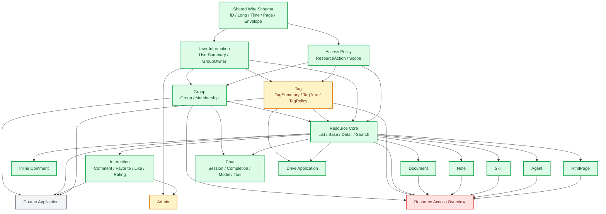

# Zod Schema 与接口边界建设方案

> 状态：除后端尚未提供的 Admin 公告 Controller、scoped Tag endpoint 与 Resource Access Overview 外，前端存量 REST 已完成 Contract 迁移；Chat 三条 SSE 流水线也已建立独立 Contract。当前基线为 154 个 Contract、2 个 unchecked REST 调用、0 个 direct fetch。
>
> 调研基线：WisePenView `main`、WisePenCloud `codex/resource-tag-tree-scoped-endpoints`（含 `origin/main`）、WisePenCloud-AI `wisepen-chat-service`。

## 一、结论

迁移前前端最紧迫的问题不是“缺少 Zod”，而是既有手写 DTO 把后端契约描述得过宽、过旧，且 146 个 REST 业务调用没有运行时响应校验。直接给现有类型补 Zod 会把错误契约固化，因此必须先分层、先修正 P0 接口差异，再逐域迁移。

建议按以下顺序推进：

1. 建立共享 wire 基础 Schema、Contract 元数据和覆盖率检查。
2. 修正现有 P0 契约事故，并冻结 Auth 作为已完成样板。
3. 建设 UserInformation、AccessPolicy、Group、Tag 四个基础域。
4. 建设 ResourceCore、ResourceAccess、ResourcePlacement。
5. 分别建设 Document、Note、Skill、Agent、HtmlPage。
6. 建设 Interact、InlineComment、Message、Wallet、UserTask、Admin。
7. 最后建设 Chat、SSE、Speech，以及 Course、Drive 两个聚合域。

总体原则是“先底座、后叶域；先消费契约、后 domain entity；先新增语义接口、后淘汰历史接口”。不要一次性批量改写全部 152 个 REST 接口。

## 二、迁移前调研范围与量化基线

以下数字用于解释迁移策略和历史问题，不代表当前覆盖率；当前结果以上方状态与 `check:api-contracts` 输出为准。

- 152 个前端 REST 业务 endpoint。
- 3 个直接 `fetch` 的聊天流式 endpoint：`POST /chat/completions`、`POST /chat/completions/recover`、`GET /chat/completions/stream`。
- 53 个手写 API 类型文件，共 859 个属性。
- 其中 505 个属性为可选，250 个属性出现 `null`，15 个属性使用 `unknown` 或开放对象。
- 152 个 REST endpoint 中只有 Auth 的 6 个使用 `ApiContract + Zod`；其余 146 个走 `apiGetUnchecked`、`apiPostUnchecked`、`apiPutUnchecked`、`apiGetText` 或直接 `fetch`。
- domain 层存在 32 组跨域类型/实现依赖。当前 service registry 的装配图已经是 DAG，但 Schema 和业务所有权仍没有按同样方向组织。

这意味着现状的 TypeScript 类型主要只是编译期断言，无法阻止后端字段改名、空值变化、枚举值漂移和响应结构破坏继续进入 mapper。

## 三、目标 DAG



当前 DAG 前沿：

- 已完成：`W Shared Wire Schema`、`A AccessPolicy`、`U UserInformation`、`G Group`、`R ResourceCore`。
- 已完成：`I Interaction`、`C InlineComment` 与 Document、Note、Skill、Agent、HtmlPage 五个资源叶域。
- 已完成：Message、Wallet、UserTask、UserTour、Chat Session/Model/Provider/Tool/Speech 与 SSE；Drive 保持纯前端聚合。
- 部分完成：`T Tag` 的通用树、命令、策略已完成，scoped endpoint 仍阻塞；`AD Admin` 的用户管理已完成，公告接口仍阻塞。
- 完全阻塞：`RA Resource Access Overview` 聚合 endpoint 尚未上线，相关权限补全 mapper 暂时不能删除。
- 待业务决策：`CO Course` 是否升级为正式后端域；当前仍只能视为高级 Group 聚合。

关键约束：

- `Shared Wire Schema` 不拥有业务规则，只表达后端序列化事实和公共结构。
- `Access Policy` 拥有 `DISCOVER / VIEW / LOAD / EDIT / ... / MARKET_VIEW` 以及访问范围，Tag、Group、Resource 都依赖它，不再让 Tag 反向依赖 Resource 来取得动作定义。
- `User Information` 只暴露稳定用户摘要；不要把完整账户资料、钱包、消息、任务全部塞进所有消费者。
- `Tag` 的树节点依赖用户摘要与访问策略，不依赖 Resource entity。
- `ResourceCore` 消费 Group、Tag、User 的摘要契约，不拥有 Tag 编辑、评论、收藏、文档解析等能力。
- `Document / Note / Skill / Agent / HtmlPage` 是 ResourceCore 之上的资源能力叶域。
- `Resource Access Overview` 是聚合器，不是 ResourceCore 的一部分。当前它放在 Resource service 内并依赖 Note、Skill、Agent 等叶域，形成了概念上的倒置依赖。
- `Course` 和 `Drive` 是产品级聚合应用，不应反向成为 Resource、Tag、Group 的基础依赖。
- `Admin` 是管理聚合入口，依赖底层业务契约，不被底层 domain 依赖。

### 当前实际依赖边

下表是本次扫描得到的 32 组跨 domain 边。`强` 表示类型或协议无法独立成立，`软` 表示只发生在 service 编排或展示摘要场景。

| 依赖边                                                               | 主要位置                             | 判断                                                        |
| -------------------------------------------------------------------- | ------------------------------------ | ----------------------------------------------------------- |
| Admin -> User                                                        | Admin user DTO、枚举、mapper         | 强；Admin 是聚合器，方向本身合理                            |
| Agent -> Resource                                                    | ResourceItem 内嵌、权限概览、service | 强；应依赖 ResourceSummary 而非完整 ResourceItem            |
| Chat -> Group、Resource                                              | 群聊输入选项与资源附件               | 软；Chat 在上层，方向合理                                   |
| Course -> Group、Interact、Resource、Tag                             | 课程聚合 service、mapper             | 软；Course 不能成为基础域                                   |
| Document -> Resource、User                                           | 详情内嵌 ResourceItem、作者摘要      | 强；应拆分 ResourceSummary/UserSummary                      |
| Drive -> Resource、Tag、User                                         | 浏览模型与系统文件夹                 | 软；Drive 是产品聚合层                                      |
| Group -> Tag、User                                                   | 默认成员动作、ownerInfo              | 强；默认动作应移到 AccessPolicy，User 用摘要                |
| HtmlPage -> Resource                                                 | 详情内嵌 ResourceItem                | 强；应依赖 ResourceSummary                                  |
| Interact -> Resource                                                 | 收藏条目内嵌 ResourceItem            | 强；应依赖 ResourceSummary                                  |
| Note -> InlineComment、Resource、User                                | 批注投影、详情、作者摘要             | 强；Resource/User 用摘要，InlineComment 单独编排            |
| Resource -> Agent、Document、Group、HtmlPage、Note、Skill、Tag、User | 权限聚合与摘要                       | 混合；User/Group/Tag Summary 是合法底座，叶域查询属于聚合器 |
| Skill -> Resource                                                    | 详情内嵌、权限概览、service          | 强；应依赖 ResourceSummary                                  |
| Tag -> Resource、User                                                | 权限动作枚举、创建者摘要             | 强；动作应移到 AccessPolicy，User 用摘要                    |
| Wallet -> User                                                       | 操作人展示摘要                       | 强；应依赖 UserSummary                                      |

当前代码没有 service 实现级循环，因为 Resource 对叶域的依赖通过 registry 注入；但类型所有权和聚合职责仍形成“底层 Resource 反过来认识所有资源叶域”的概念循环。Schema 建设不能照搬当前 `ResourceServicesMap` 的聚合方式。

## 四、推荐 API 域拆分

### 1. Account 与 Directory

从当前 User 域拆成：

- `UserInformation`：`UserSummary`、当前用户展示信息、用户搜索与补全。
- `AccountProfile`：账号展示字段、学籍资料、CRUD 字段边界。
- `IdentityVerification`：邮箱、Provider 列表、发起、挑战、状态查询。
- `UserTask`、`UserTour`、`Message`、`Wallet`：继续保持独立业务域，不并回 UserInformation。
- `Feedback`：若继续扩展，独立为 Support/Feedback API，不再混在 UserApi。

### 2. Resource 与 Access

从当前 Resource 域拆成：

- `ResourceCore`：列表、基础信息、详情、搜索、重命名、删除。
- `ResourcePlacement`：个人路径、回收站、小组挂载、卸载、移动。
- `ResourceTag`：标签树、标签 CRUD、标签策略。
- `ResourceAccess`：动作集合、主体权限、权限概览、批量授权。
- `ResourceInteraction`：评论、收藏、点赞、阅读、评分。
- `ResourceMarket`：若产品需要展示或购买集市资源，应补前端 domain，而不是继续让 `ResourceItemResponse.marketSaleInfos` 被 Schema 静默丢弃。

### 3. AI 与 Chat

当前 Chat API 文件应拆成独立 Schema/Contract 组：

- `ChatSessionApi`
- `ChatCompletionApi`
- `ChatModelApi`
- `ChatProviderApi`
- `ChatToolApi`
- `SpeechCredentialApi`

它们都属于 Chat 产品边界，但不属于同一个 service 变化原因。Chat 主服务可以继续做编排，API Contract 与测试应独立。

Skill 与 Agent 可以共享 `VersionAssetSchema`、`AssetUploadTicketSchema` 等 Schema，但是否共用 Controller 由后端资源语义决定，不以“防止重复代码”为名合并两个业务入口。

### 4. Product Applications

- `Course` 不应长期只是 Group、Tag、Resource、Interact 的临时拼接。若课程是正式产品域，应新增后端 Course API/Controller 与 Course DB 模型。
- `Drive` 可以继续作为前端浏览聚合层，但只能依赖 Resource 和 Tag 的稳定 service 契约，不拥有自己的后端 endpoint。

## 五、P0：已经确认的严重接口问题

| 问题                                                                         | 证据                                                                                                                                                      | 影响                                               | 建议                                                                                                |
| ---------------------------------------------------------------------------- | --------------------------------------------------------------------------------------------------------------------------------------------------------- | -------------------------------------------------- | --------------------------------------------------------------------------------------------------- |
| Admin 公告接口不存在于当前 Cloud Controller                                  | View 调用 `/admin/message/listMessages`、`/admin/message/publishMessage`；Cloud 只有内部 `/internal/user/message/publishMessage` 和个人 `/user/message/*` | 管理公告页面在正式环境很可能 404；mock 掩盖问题    | 新增受管理员权限保护的 `AdminMessageController`，公开列表与发布接口；禁止前端调用 internal endpoint |
| Admin 用户过滤与更新字段名错误                                               | 前端发 `status`，后端 `AdminUserController` 接收 `userStatus`；`UserInfoAdminUpdateRequest` 也只有 `userStatus`                                           | 状态筛选/修改失效或被忽略                          | 统一为 `userStatus`；Zod request 中启用严格对象，未知字段直接失败                                   |
| Note 详情响应声明错误                                                        | 后端 `NoteInfoResponse` 返回 `updateTime`；前端声明 `noteInfo.lastUpdatedAt`                                                                              | 最后编辑时间在正式环境为空                         | Contract 对齐 `updateTime`；`noteInfo` 除非后端新增，否则删除                                       |
| Note 版本列表声明错误                                                        | 后端返回 `PageR<NoteVersionInfoResponse>`，前端大量声明 `type/createdBy` 可选字段与整页可空                                                               | mapper 长期使用空白 fallback，错误不可见           | 以精确版 PageResult 和版本摘要 Schema 替换                                                          |
| Chat Provider 计费字段不一致                                                 | 后端返回 `input_tokens / cached_input_tokens / output_tokens / billable_tokens`；前端读取 `token_usage / billable_token_usage`                            | mapper 得到 `undefined`，用量展示错误              | 后端统一为一个 `usage` 对象，或前端立即按真实字段建模；不能继续由 mapper 猜                         |
| Chat Session 请求含后端不存在的字段                                          | 前端发送 `agent_version`；Python `CreateSessionRequest / SetSessionAgentRequest` 不接收该字段                                                             | 字段被忽略，形成虚假契约                           | 删除 `agent_version` 请求字段；版本完全由后端解析 `agent_id` 决定                                   |
| Speech 请求体形状不一致                                                      | 后端接收 `{ provider, options }`；前端发送顶层 `{ eos_ms }`                                                                                               | 依赖 Pydantic 忽略未知字段与默认值，语义脆弱       | Contract 改为 `{ provider: 'IFLYTEK', options: { eos_ms } }`                                        |
| Java 时间统一是毫秒数，前端大量声明为 string                                 | Cloud `JacksonConfiguration` 将 `LocalDateTime` 序列化为 epoch milliseconds                                                                               | Zod 一启用就会大面积失败；当前类型无法保护日期解析 | 分开定义 `EpochMillisSchema` 与 Python 的 `IsoDateTimeSchema`                                       |
| GroupType / GroupRoleType / IdentityType 是数字，AccessControlScope 是字符串 | 后端 `@JsonValue` 不一致；前端类型混用 number/string                                                                                                      | 枚举漂移和 mapper 兼容逻辑长期存在                 | 逐枚举冻结 canonical wire value；不得用 number 或 string 的联合兜底                                 |
| `ResourceAction` 缺少后端 `MARKET_VIEW`                                      | Cloud enum 内部使用 `MARKET_VIEW(512)`，JSON 仍返回枚举名称；AccessPolicy 已补齐动作集合、Schema 与隐含动作                                               | 已在核心层修复，前端不再维护动作位掩码             | 后续 Contract 只使用 `ResourceActionSchema`，不接受数字动作或宽泛联合                               |
| Course 缺少正式后端契约                                                      | 课程元数据塞在 Group JSON 字符串；创建课程由 Group、Tag、Group 更新三次请求完成；公告/作业返回 unavailable                                                | 无事务、无字段校验、无法稳定演进                   | 若课程是正式域，新增 Course API、DTO、Controller 和事务化命令                                       |
| 查询/删除大量使用 POST                                                       | Agent/Skill/HtmlPage 的 get 使用 POST；多个 delete/remove 使用 POST                                                                                       | 缓存、幂等、可观测性和网关策略无法按 HTTP 语义工作 | 修 Schema 时保留兼容入口，同时新增语义化 v2 接口；不要只在前端把 POST 改名                          |

## 六、完整接口处置矩阵

标记说明：

- `C`：保留当前 endpoint，补 Zod、类型推导和运行时解析。
- `M`：补 Schema 的同时删除机械 mapper。
- `B`：需要先改后端 wire、字段名、枚举、参数或响应 DTO。
- `N`：建议新增语义化 endpoint/controller。
- `S`：文本、multipart 或 SSE 等特殊传输。

### Auth

| 接口                                                                                                                                                | 决策                                                                  |
| --------------------------------------------------------------------------------------------------------------------------------------------------- | --------------------------------------------------------------------- |
| `POST /auth/login`、`POST /auth/logout`、`POST /auth/register`、`POST /auth/sendResetMail`、`POST /auth/resetPassword`、`POST /auth/changePassword` | 保持为样板；补 transport/method 元数据和共享空响应 Schema，不重写业务 |

### Admin

| 接口                                                                    | 决策                                                                              |
| ----------------------------------------------------------------------- | --------------------------------------------------------------------------------- |
| `GET /admin/message/listMessages`、`POST /admin/message/publishMessage` | `B + N`：新增 AdminMessageController 与响应 DTO；补分页、筛选、发布命令契约       |
| `GET /admin/user/getUserList`                                           | `B + C`：参数改 `userStatus`；UserId 为 Long 字符串；列表响应不得暴露 Entity      |
| `GET /admin/user/getUserInfo`                                           | `B + C`：明确这是 profile-only 响应；精确 LocalDateTime 毫秒类型                  |
| `POST /admin/user/changeUserInfo`                                       | `B + C`：`status` 改 `userStatus`；严格 request；枚举按后端真实 wire value        |
| `POST /admin/user/changeUserProfile`                                    | `C + M`：字段级 optional、null 和枚举 Schema；合并重复请求 mapper                 |
| `POST /admin/user/resetPassword`                                        | `B + C`：把“缺省 newPassword 使用系统默认密码”改成显式模式，避免 omitted 语义含糊 |

### Agent

| 接口                                                                                                        | 决策                                                                                                 |
| ----------------------------------------------------------------------------------------------------------- | ---------------------------------------------------------------------------------------------------- |
| `POST /agent/getAgentInfo`、`POST /agent/getAgentVersionBundleInfo`                                         | `B + C`：查询接口新增 GET 语义版本；旧 POST 冻结为兼容入口                                           |
| `POST /agent/createAgent`                                                                                   | `C`：响应应为必填非空 resourceId；后端虽有 forkAgent，但 View 当前未接线，不在本矩阵伪列为已消费接口 |
| `POST /agent/changeAgentInfo`、`POST /agent/updateAgentSpec`、`POST /agent/publishAgentVersion`             | `C + M`：严格 command Schema；AgentSpec 由后端提供稳定默认值，删除大面积 fallback                    |
| `POST /agent/initUploadAgentAssets`、`POST /agent/cancelUploadAgentAssets`、`POST /agent/deleteAgentAssets` | `C + M`：上传 ticket 必填性按真实响应区分；`draftVersion`、`assetId` 必填                            |

### Chat

| 接口                                                                                                                                             | 决策                                                                                                   |
| ------------------------------------------------------------------------------------------------------------------------------------------------ | ------------------------------------------------------------------------------------------------------ |
| `GET /chat/model/listAvailableModels`                                                                                                            | `C`：拆 `ChatModelApi`；建立 Model/Mapping discriminated schema                                        |
| `GET /chat/model/listModels`、`GET /chat/model/listUserProviders`                                                                                | `C`：精确 wire 字段；Provider usage 采用后端 canonical 字段                                            |
| `POST /chat/model/createUserProvider`、`POST /chat/model/updateUserProvider`、`POST /chat/model/deleteUserProvider`                              | `C`：拆分 create/update/delete Schema；update 保留 presence 语义                                       |
| `POST /chat/model/createUserModel`、`POST /chat/model/updateUserModel`、`POST /chat/model/deleteUserModel`                                       | `C`：模型能力字段必须 strict；不接受任意大小写                                                         |
| `POST /chat/model/bindModelProvider`、`POST /chat/model/unbindModelProvider`                                                                     | `C`：计费比例必须是十进制字符串；请求补全当前遗漏的计费字段契约                                        |
| `GET /chat/tool/listUserTools`、`POST /chat/tool/updateUserToolConfig`、`POST /chat/tool/deleteUserToolConfig`                                   | `C`：`config_schema` 保留为 JSON Schema；secret 只允许字符串 map                                       |
| `POST /chat/attachment/initUploadTemporaryAttachment`                                                                                            | `C + M`：`put_url`、`callback_header` 按后端必填；MD5、extension、size 上限进入 Schema                 |
| `POST /chat/session/createSession`、`POST /chat/session/setSessionAgent`、`POST /chat/session/renameSession`、`POST /chat/session/deleteSession` | `B + C`：共享完整 `SessionResponse`；删除不存在的 `agent_version` 请求字段；删除/重命名改 v2 HTTP 语义 |
| `GET /chat/session/listSessions`、`GET /chat/session/listHistoryMessages`                                                                        | `C`：PageResult 用 snake_case wire Schema；历史消息使用 discriminated UI part union                    |
| `GET /chat/completions/active`、`POST /chat/completions/cancel`                                                                                  | `C`：`turn_id` 明确 nullable；cancel 改为幂等命令 Schema                                               |
| `POST /chat/completions`、`POST /chat/completions/recover`、`GET /chat/completions/stream`                                                       | `S`：SSE 事件逐个用 Zod 校验；禁止 unknown part 静默丢弃，建立完整事件联合                             |

### Document

| 接口                                                                                                | 决策                                                                                                          |
| --------------------------------------------------------------------------------------------------- | ------------------------------------------------------------------------------------------------------------- |
| `POST /document/uploadDoc`                                                                          | `C + M`：保留首次上传；若支持覆盖版本，`resourceId` 使用明确 nullability；service 直接使用 `mountTargetTagId` |
| `GET /document/listPendingDocs`                                                                     | `C`：待处理状态用枚举联合；documentId 必填性由真实 DTO 确认                                                   |
| `POST /document/syncDocStatus`、`POST /document/retryDocProcess`、`POST /document/cancelDocProcess` | `C`：命令 Schema；理想 v2 使用显式命令接口                                                                    |
| `GET /document/getDocInfo`                                                                          | `C`：精确文档版本、状态、作者展示；禁止大量 optional fallback                                                 |
| `POST /document/forkDocument`                                                                       | `C`：fork 名称必填；返回值必填非空                                                                            |
| `GET /document/onlyoffice/editorConfig`                                                             | `C`：`sessionId/config` 是否可空必须由后端明确，request Schema 先行                                           |

### Group

| 接口                                                                                                                                          | 决策                                                                                                     |
| --------------------------------------------------------------------------------------------------------------------------------------------- | -------------------------------------------------------------------------------------------------------- |
| `GET /group/list`                                                                                                                             | `B + C`：GroupType、GroupRoleFilter canonical wire；分页上限进入 Schema                                  |
| `GET /group/getGroupBaseInfo`、`GET /group/getGroupDetailInfo`                                                                                | `B + C`：GroupType 数字；权限差异留在 service；删除请求参数 mapper                                       |
| `POST /group/addGroup`                                                                                                                        | `B + C + M`：GroupType 改为后端可稳定反序列化的 canonical 值；响应 Long 字符串                           |
| `POST /group/changeGroup`、`POST /group/removeGroup`、`POST /group/joinGroup`                                                                 | `C + M`：严格 command Schema；删除 identity request mapper                                               |
| `GET /group/member/list`、`GET /group/member/getMyRole`、`GET /group/member/getMyGroupMemberInfo`、`GET /group/member/getAllMyGroupTokenInfo` | `B + C`：GroupRole 后端是数字；去掉 string 角色兼容；Long ID 为字符串                                    |
| `POST /group/member/changeRole`、`POST /group/member/kick`、`POST /group/member/quit`、`POST /group/member/changeTokenLimit`                  | `C + M`：批量成员命令 Schema；role、token limit 精确类型                                                 |
| `GET /resource/groupConfig/getConfig`、`POST /resource/groupConfig/changeConfig`                                                              | `B + C`：接口实际属于 GroupResConfig；前端仍可经 Group service 编排；`fileOrgLogic` 不要在前端硬编码覆盖 |

### HtmlPage 与 Image

| 接口                                           | 决策                                                                        |
| ---------------------------------------------- | --------------------------------------------------------------------------- |
| `POST /singleHtmlPage/getSingleHtmlPageInfo`   | `B + C`：查询应新增 GET 版本；旧 POST 冻结兼容                              |
| `GET /singleHtmlPage/getSingleHtmlPageContent` | `S`：保留文本传输；定义 content-type、错误 envelope、最大长度与可信渲染边界 |
| `POST /storage/imageUpload`                    | `S`：multipart request contract；File、scene、bizTag、大小和 MIME 校验      |

### InlineComment

| 接口                                                                                                                        | 决策                                                                     |
| --------------------------------------------------------------------------------------------------------------------------- | ------------------------------------------------------------------------ |
| `GET /resource/inlineComment/listInlineComments`                                                                            | `C + M`：响应结构严格化；anchor 改为带 editor 类型的 discriminated union |
| `POST /resource/inlineComment/createInlineComment`                                                                          | `C`：`anchorPayload` 不再接受无约束对象；版本字段明确                    |
| `POST /resource/inlineComment/addInlineCommentItem`、`POST /resource/inlineComment/updateInlineCommentItem`                 | `C + M`：共享 item command Schema；删除 identity mapper                  |
| `POST /resource/inlineComment/setInlineCommentItemReaction`、`POST /resource/inlineComment/deleteInlineCommentItemReaction` | `C + M`：v2 用 PUT/DELETE 表达 desired state；删除 identity mapper       |
| `POST /resource/inlineComment/deleteInlineCommentItem`                                                                      | `C + M`：v2 使用 DELETE；补 expectedVersion 防并发覆盖                   |
| `POST /resource/inlineComment/changeInlineCommentResolveStatus`                                                             | `C + M`：改成显式 `resolved: boolean` command；删除 identity mapper      |

### Interact

| 接口                                                                                                                                          | 决策                                                                                    |
| --------------------------------------------------------------------------------------------------------------------------------------------- | --------------------------------------------------------------------------------------- |
| `GET /resource/comment/listComments`、`GET /resource/comment/listReplies`                                                                     | `C`：分页与排序枚举严格化；sortBy 必填语义按后端固定                                    |
| `POST /resource/comment/createComment`、`POST /resource/comment/createReply`                                                                  | `C`：content、图片 URL、目标 comment 关系严格化                                         |
| `POST /resource/comment/deleteCommentItem`                                                                                                    | `C`：v2 使用 DELETE                                                                     |
| `POST /resource/comment/toggleLike`                                                                                                           | `B + C + N`：新增 `{ liked: boolean }` 的幂等 set-like endpoint；当前 toggle 只保留兼容 |
| `GET /resource/favorite/getResourceFavoriteStatus`、`GET /resource/favorite/listCollections`、`GET /resource/favorite/listFavoritedResources` | `C + M`：集合 ID 使用非空字符串；分页结果必填字段精确                                   |
| `POST /resource/favorite/changeResourceFavoriteStatus`                                                                                        | `B + C`：明确 collectionIds 为空时是“取消全部收藏”还是无操作                            |
| `POST /resource/favorite/createCollection`、`POST /resource/favorite/updateCollectionInfo`、`POST /resource/favorite/deleteCollection`        | `C + M`：command Schema；request 字段可直接对齐后删除机械 mapper                        |
| `GET /resource/interaction/getResourceUserInteractionRecord`                                                                                  | `C`：缺记录时是 null 还是全默认对象必须由后端固定                                       |
| `POST /resource/interaction/read`、`POST /resource/interaction/rate`                                                                          | `C`：阅读/评分 command 严格化                                                           |
| `POST /resource/interaction/toggleLike`                                                                                                       | `B + C + N`：同评论点赞，改为幂等 liked boolean command                                 |

### Message

| 接口                             | 决策                                                                                                                    |
| -------------------------------- | ----------------------------------------------------------------------------------------------------------------------- |
| `GET /user/message/listMessages` | `B + C + M`：后端 `MessageType` 包含 `RESOURCE_INTERACTION`，前端必须补齐；删除请求/响应默认值 fallback                 |
| `POST /user/message/readMessage` | `C + M`：messageIds 非空数组；后端已有 unread count、read all、remove，可按产品需要补 API Contract，但不需新 Controller |

### Note

| 接口                               | 决策                                                                            |
| ---------------------------------- | ------------------------------------------------------------------------------- |
| `POST /note/addNote`               | `C + M`：resourceId 必填非空；删除空字符串 fallback                             |
| `GET /note/getNoteInfo`            | `B + C + M`：使用后端 `updateTime` 与 `authorsDisplay`，删除不存在的 `noteInfo` |
| `GET /note/getDrawIOLatestVersion` | `C + M`：resource/version 必填；空 FULL snapshot 用 nullable                    |
| `POST /note/saveDrawIOSnapshot`    | `C + M`：Base64 data、version、resourceId 严格化；删除 identity title map       |
| `POST /note/forkNote`              | `C + M`：fork 名称/版本规则精确；非空返回                                       |
| `GET /note/listNoteVersions`       | `B + C + M`：按后端 PageR 修正，禁止整页 optional                               |

### Resource

| 接口                                                                                                                                                                  | 决策                                                                                                 |
| --------------------------------------------------------------------------------------------------------------------------------------------------------------------- | ---------------------------------------------------------------------------------------------------- |
| `GET /resource/item/listResources`                                                                                                                                    | 已完成 `C + M`：列表响应单独建模；ResourceType、Action、排序枚举严格；Long size 字符串               |
| `POST /resource/item/renameResource`、`POST /resource/item/removeResources`                                                                                           | 已完成 `C`：command Schema 与非空 ID 数组；v2 delete 使用 DELETE                                     |
| `POST /resource/item/changeResourceActionPermission`                                                                                                                  | 已完成 `C`：保留 `undefined/null/[]` 三态；v2 显式 operation 数组仍待 `B + N`                        |
| `GET /resource/search/globalSearchResources`                                                                                                                          | 已完成 `C + M`：SearchScope、ResourceType、分页与毫秒时间严格；highlight 语义固定                    |
| `POST /resource/placement/setPersonalResourcesPathTag`、`POST /resource/placement/movePersonalResourcesToTrash`、`POST /resource/placement/replacePersonalNormalTags` | 已删除机械 request mapper，service 直接传递同形参数；checked Contract 仍待 `C`                       |
| `POST /resource/placement/mountResourcesToGroup`、`POST /resource/placement/unmountResourcesToGroup`、`POST /resource/placement/moveResourcesInGroup`                 | `B + C + N`：新增 `POST /resource/placements` 批量命令并返回逐项结果；只返回请求数量无法处理部分失败 |
| 新增 `POST /resource/access/overviews`                                                                                                                                | `N`：替代前端按资源类型调用多个详情接口后再补 Group/Tag 的 N+1 聚合                                  |

### Skill

| 接口                                                                                                        | 决策                                                               |
| ----------------------------------------------------------------------------------------------------------- | ------------------------------------------------------------------ |
| `POST /skill/getSkillInfo`、`POST /skill/getSkillVersionBundleInfo`                                         | `B + C`：新增 GET 版本；旧 POST 兼容                               |
| `GET /skill/getSkillAssetStsToken`                                                                          | `C`：STS 字段按后端 required；targetVersion 规则精确               |
| `POST /skill/createSkill`、`POST /skill/forkSkill`                                                          | `C`：resourceId 必填非空                                           |
| `POST /skill/changeSkillInfo`                                                                               | `C`：resourceId 必填；current type 不应 optional                   |
| `POST /skill/initUploadSkillAssets`、`POST /skill/cancelUploadSkillAssets`、`POST /skill/deleteSkillAssets` | `C + M`：上传资产类型由后端权威返回，删除按扩展名猜测的重复 mapper |
| `POST /skill/publishSkillVersion`                                                                           | `C`：command Schema                                                |

### Speech

| 接口                              | 决策                                                                                                                            |
| --------------------------------- | ------------------------------------------------------------------------------------------------------------------------------- |
| `POST /chat/speech/getCredential` | `B + C`：改为 `{ provider, options }`；credential 使用 provider-specific union；EOS 范围与 URL host 继续在 service/验证边界校验 |

### Tag

| 接口                                                                                                                        | 决策                                                                                                    |
| --------------------------------------------------------------------------------------------------------------------------- | ------------------------------------------------------------------------------------------------------- |
| `GET /resource/tag/getTagTree`                                                                                              | 已完成 `C`：作为当前线上唯一 Tag 树读取入口，由 service 继续使用                                        |
| 新增前端迁移目标 `GET /resource/tag/getPersonalTagTree`、`GET /resource/tag/getGroupTagTree`                                | 阻塞 `B + C + N`：后端未上线前不得调用；上线后再迁移并按个人/小组作用域读取                             |
| `POST /resource/tag/addTag`、`POST /resource/tag/changeTag`、`POST /resource/tag/moveTags`、`POST /resource/tag/removeTags` | 已完成 `C + M`：精确 Scope/Action 字符串枚举；grantedActions 单一事实源；tagMetaInfo 保留 v1 字符串兼容 |

### User

| 接口                                                                               | 决策                                                                                                |
| ---------------------------------------------------------------------------------- | --------------------------------------------------------------------------------------------------- |
| `GET /user/getUserInfo`                                                            | `C + M`：精确 UserInfo/UserProfile；readonlyFields 改为已知字段枚举                                 |
| `GET /user/searchUser`、`GET /user/listUserSearchSuggestions`                      | `C + M`：Long userId 字符串；keyword/size 约束精确；可新增合并候选查询 endpoint，消除前端双请求合并 |
| `PUT /user/changeUserInfo`、`PUT /user/changeUserProfile`                          | `B + C + M`：用 PATCH/JSON Merge Patch 明确 omitted 与 null；当前 UI 两次 PUT 非原子                |
| `POST /user/verify/initiateEmailVerify`、`GET /user/verify/checkEmailVerify`       | `C + M`：email/token Schema                                                                         |
| `POST /user/verify/initiateFudanUISVerify`、`GET /user/verify/checkFudanUISVerify` | `B + D`：后端已标 Deprecated；迁移到通用 Campus Identity API，不再扩展旧字段                        |
| `GET /user/invite/listRecords`                                                     | `C + M`：PageResult 与 Long 字符串精确                                                              |
| `POST /system/feedback/addFeedback`                                                | `B + C + N`：把五个布尔值改为 `types: FeedbackType[]`；需要新 DTO 或 v2 endpoint                    |
| `GET /user/task/listTaskStatus`、`POST /user/task/dailyCheckIn`                    | `C`：Task 响应按 taskType 使用 discriminated union                                                  |
| `GET /user/tour/listTourStatus`、`POST /user/tour/completeTour`                    | `C`：TourCode 严格枚举                                                                              |

### Wallet

| 接口                                                 | 决策                                                                                          |
| ---------------------------------------------------- | --------------------------------------------------------------------------------------------- |
| `GET /user/wallet/getUserWalletInfo`                 | `C + M`：余额是 Integer number，非 number/string union；删除默认 0 掩盖缺失                   |
| `POST /user/wallet/redeemVoucher`                    | `C + M`：voucherCode 严格；删除 identity mapper                                               |
| `GET /user/wallet/listTransactions`                  | `C + M`：流水枚举、Long operator/traceId、时间戳精确；保留 legacy enum 兼容到后端数据迁移完成 |
| `POST /user/wallet/transferTokenBetweenGroupAndUser` | `C`：tokenTransferType 后端确有字段；正数、groupId 和方向严格                                 |

## 七、Mapper 处置清单

### 可以直接删除的机械 mapper

Group 文档中列出的请求映射、创建响应映射、成员请求映射与角色编号字符串转换已删除。其余域在 API Schema 与服务入参命名对齐后，以下函数没有独立语义：

- `UserServicesMap`：`mapSendEmailVerifyRequest`、`mapConfirmEmailVerifyRequest`、`mapListInviteRecordsRequest`。
- `MessageServicesMap`：`mapListUserMessagesRequest`、`mapReadMessagesRequest`。
- `AdminMessageServicesMap`：`mapListAdminMessagesRequest`。
- `NoteServicesMap`：`mapSyncTitleRequest`；响应非空后删除 `mapCreateNoteFromApi`、`mapForkNoteFromApi` 的空值兼容。
- `InlineCommentServicesMap`：`mapSetReactionRequest`、`mapDeleteReactionRequest`、`mapDeleteItemRequest`、`mapResolveRequest`、`mapCreatedId`。
- `ResourceServicesMap`：全部 placement request 复制函数、`mapResourcePlacementCountFromApi`。
- `WalletServicesMap`：`mapRedeemVoucherRequest`。
- `ChatServicesMap`：`mapCreateSessionFromApi`、`mapSetSessionAgentFromApi`、`mapRenameSessionFromApi` 三个别名；`mapActiveTurnIdFromApi` 可在 Contract 类型对齐后内联。

### 应保留但可显著缩小的 mapper

- `AgentServicesMap.mapSpec`：当前大量 fallback 是因为 response 全 optional；后端保证完整默认 spec 后只保留领域命名差异。
- `TagServicesMap`：只消费 `grantedActions` 集合，不读取 `taggedResourceGrantedActionsMask`；标签 metadata JSON 兼容仍保留。
- `WalletServicesMap`：当前对 unknown 交易类型、金额、时间做兼容；数据迁移完成后改为枚举/数字直读。
- `ChatServicesMap`：snake_case 到 camelCase、UI message 投影仍需 mapper；但不能再以 unknown 和静默丢弃承载契约错误。
- `SkillServicesMap.mapSkillFilesFromApi`：目录树构建是真实领域转换，应保留。
- `CourseServicesMap`、`DriveServices`：是聚合模型与领域规则，不是多余 mapper；但 Course 长期应下沉为后端正式域。

### 可由后端聚合而整体消失的 mapper

- `resourcePermission.mapper.ts` 与 `resourcePermissionHydration.mapper.ts` 合计 436 行。若新增 Resource Access Overview endpoint，让后端一次返回 owner/group/tag/override/specifiedUser 主体和 effective/editable/inherited actions，这两个文件的职责可由稳定 DTO 取代。
- 当前 `ResourcePermissionServices` 会按小组并发查询 Group 和 Tag，存在 N+1 式网络扇出；这不是 schema 能彻底解决的问题。

## 八、Zod Schema 建设结构

建议目录：

```text
src/
├── apis/
│   ├── schema/
│   │   ├── empty.ts
│   │   ├── envelope.ts
│   │   ├── ids.ts
│   │   ├── index.ts
│   │   ├── page.ts
│   │   ├── string.ts
│   │   └── time.ts
│   ├── contract.ts
│   ├── executeApiContract.ts
│   ├── request.ts
│   └── runtimeContract.ts
└── domains/
    ├── _shared/
    │   └── access/
    │       └── AccessPolicy.schema.ts
    ├── User/
    │   └── apis/
    │       ├── UserInformationApi.schema.ts
    │       ├── AccountProfileApi.schema.ts
    │       ├── IdentityVerificationApi.schema.ts
    │       └── ...
    └── Resource/
        └── apis/
            ├── ResourceCoreApi.schema.ts
            ├── ResourcePlacementApi.schema.ts
            ├── ResourceAccessApi.schema.ts
            ├── ResourceInteractionApi.schema.ts
            └── ...
```

### 1. Contract 已表达的元数据

Wave 0 已让 Contract 强制包含 HTTP method、请求位置和 transport：

```ts
interface ApiContract<Request, Response> {
  name: string;
  method: 'GET' | 'POST' | 'PUT' | 'PATCH' | 'DELETE';
  endpoint: string;
  requestPlacement: 'body' | 'query' | 'none';
  transport: 'json' | 'multipart' | 'sse' | 'text';
  request: ZodType<Request>;
  response: ZodType<Response>;
}
```

当前 `executeApiContract` 实现 JSON transport，历史文本、multipart 与 SSE 仍走白名单入口。后续需要把特殊 transport 改为显式执行器，而不是把所有传输都继续塞进 JSON helper：

```ts
type ApiTransport =
  | { kind: 'json' }
  | { kind: 'text'; maxBytes?: number }
  | { kind: 'multipart' }
  | { kind: 'sse'; event: ZodType<unknown> };
```

API 方法最终只负责：

1. 绑定 Contract 与业务参数。
2. 调用统一 transport。

请求校验、envelope 解包和 payload 校验已由 `executeApiContract` 集中完成。

不要再让每个 API 文件复制同一套 parse 顺序。

### 2. ID 与时间 Schema

至少区分：

- `NonEmptyStringSchema`：普通非空字符串，不 trim，保留密码等值的空白语义。
- `JavaLongStringSchema`：后端 Jackson 已将 Long 序列化为字符串，使用数字字符串校验，不再接受 number。
- `ObjectIdStringSchema`：Mongo ObjectId，24 位十六进制。
- `OpaqueIdSchema`：Resource ID 等跨服务不透明字符串，只校验非空。
- `EpochMillisSchema`：Java `LocalDateTime` 当前 wire 格式。
- `IsoDateTimeSchema`：Python Chat 返回的 ISO 时间。

禁止一个 `TimestampSchema` 同时接受 string、number、Date，否则类型漂移会被悄悄吞掉。

### 3. 枚举契约与前端 `defineEnum`

前端枚举工具已经由 `createEnum` 统一重构为 [`defineEnum`](../../src/utils/type/enum.ts)。同一个函数按输入区分两种模式：

```ts
// 身份枚举：key 与 value 相同
defineEnum(['DRAFT', 'PUBLISHED'] as const);

// 映射枚举：前端 key -> 后端 wire value
defineEnum({ STUDENT: 1, TEACHER: 2 } as const);
```

它的职责是收敛前端领域枚举值、有序选项和查询入口，不是替代 API 运行期校验：

- 身份枚举只写一次字符串，不再重复声明 `key/value`；映射枚举才写对象。
- 枚举结果统一提供只读 `key/value` 选项，不再承载静态展示文案或任意扩展字段。
- 返回值直接暴露枚举属性（如 `RESOURCE_ACTION.VIEW`），同时提供有序的 `options`。
- 通过 `getOption(value)` 获取完整枚举项，通过 `isValue(value)` 做收窄判断。
- `EnumKey`、`EnumValue` 均从 `options` 推导；身份枚举直接使用 `EnumValue`，不再额外维护同义 `*Key` 类型。
- 只有映射枚举需要区分 `EnumKey` 与 `EnumValue`，例如 `ROLE` 的 `OWNER` 对应数值 `0`。
- 展示文案属于 i18n 或 view 映射，不再放回枚举定义。`defineEnum.isValue` 只检查当前前端配置中是否存在该值，不能替代带字段路径和错误诊断的 Zod 校验。

每个后端枚举进入 Contract 时仍须建立精确的 `z.enum([...])`：

- 数字 wire enum：IdentityType、GroupType、GroupRoleType。
- 字符串 wire enum：UserStatus、Gender、DegreeLevel、MessageType、MessageDeliveryScope、AccessControlScope、FileOrganizationLogic。
- ResourceAction 的领域值与请求名称统一使用字符串数组并包含 `MARKET_VIEW`；前端不读取或维护后端动作位掩码。
- ResourceType 保留后端大写值，entity 再归一为小写或 ResourceKind。

`defineEnum` 与 wire Schema 的 canonical value 必须保持一致；需要 key/value 转换时由领域 mapper 完成。不能因为 `defineEnum.isValue` 能接受 `unknown`，就重新引入 `NumericEnumApiValue = number | string` 作为接口公共拖底。

### 4. optional、nullable 与空 response

- Request：字段省略才有 `.optional()`；显式 `null` 只在后端确实允许清空时使用 `.nullable()`。
- Response：后端 JSON 一定包含的字段必须 required；只有确实可能缺失的灰度兼容字段才 optional。
- `undefined` 不应出现在 JSON response 中；空返回值用 `z.null()`，空集合仍使用 `z.array(...)`，不改成 null。
- `z.undefined` 只用于无 body 的请求 Contract。
- `z.coerce`、`.default()`、`.catch()` 不用于业务 wire；历史兼容必须进入命名明确的 mapper，并在方案中列出退场条件。

### 5. 请求严格、响应宽容

- Request Schema 使用 `z.strictObject`：前端多传字段应视为契约错误，避免 `status` 拼错成后端静默忽略。
- Response Schema 使用普通 `z.object`：允许后端新增字段并剥离，保证向后兼容。
- 对枚举字段，新增后端值不是“普通新增字段”；必须明确版本策略，禁止 mapper 静默丢弃未知值。

### 6. 开放 payload 必须有边界

- Tool 的 `config_schema` 是 JSON Schema，可作为受控开放对象。
- Tag extension metadata、InlineComment anchorPayload 必须带 schema/version 或 Editor kind。
- Chat UI tool part 必须使用 `dynamic-tool` 等标准 discriminated union；不允许每个 part 长期是 `unknown`。

## 九、渐进实施波次

### Wave 0：契约内核与基准（已完成）

- [x] 新增 [共享 Schema](../../src/apis/schema)：`NonEmptyStringSchema`、ID、time、page、envelope 和 empty response。
- [x] 将 `PageR.total` 按 Java primitive Long 的字符串 wire 解析，并在契约边界转回安全整数，避免分页响应在真实联调中被误报。
- [x] 为 Contract 增加 method/request location/transport。
- [x] 建立 `check:api-contracts`：每个域 API 方法必须绑定 checked Contract；`Unchecked` 只能存在于迁移白名单。
- [x] 将公共命名收敛为 `defineApiContract` 与 `executeApiContract`，传输细节只存在于 Contract 字段。
- [x] Auth 迁移到 `executeApiContract` 并将请求对象收紧为 `z.strictObject`，作为 golden sample。
- [x] 将 `apiGetUnchecked/apiPostUnchecked/apiPutUnchecked/apiDeleteUnchecked` 标记为 `@deprecated`。
- [x] 将 `NumericEnumApiValue` 标记为 `@deprecated`，作为各域精确 enum 迁移后的删除项。
- [x] 增加共享 Schema、Contract 调用、Auth 契约和静态边界测试。
- [x] 建立 6 个 Contract、146 个待迁移 REST 调用的可下降基线。
- [x] 为 Note 时间/版本、Feedback type/browser、Chat Provider usage、Chat Agent version、Speech body 等已修复 P0 差异补正反例测试；Admin 公告等待后端 Controller。

Wave 0 的提交为 `f804527e feat(api): 建立 Zod 契约内核与迁移基线`。

### Wave 0.5：公共 API 基础层瘦身

- 将仅内部使用的 `parseTextApiResponse` 收回模块私有，不扩大公共导出面。
- 保持 checked transport 方法不变；它们虽共享内部实现，但分别约束 HTTP 参数形态，当前合并收益低。
- 等 146 个存量调用清零后，整体删除四个 deprecated 的 unchecked transport。
- 将 `KeyedApiResponse`、`PythonApiResponse`、`ApiResponse`、`PageApiRequest`、`PageR` 等手写类型逐步改为 Schema 推导，消除类型与运行期 Schema 双事实源。
- 清理当前无外部消费者的 `Nullable`、`InfrastructureApiErrorBody`、`ApiErrorBody` 前，先完成 API error 类型归属确认。
- 不在 Wave 0.5 合并或删除 `defineApiContract`、`executeApiContract`、`parseApiRequest/Response`、`isApiResponseEnvelope` 与 `parseApiErrorBody`；它们职责不同。
- 静态审计确认当前 152 个领域 API 方法均被 service 调用，没有可立即删除的完全未使用方法。

### Wave 0.6：前端枚举工具重构（已完成）

- [x] 将 `createEnum` 重命名为 `defineEnum`，并迁移全部领域调用点。
- [x] 将枚举项收敛为只读 `{ key, value }`，移除静态标签以及 `labels`、`values`、`configs` 等重复字典。
- [x] 移除未使用的 `getKey`、`configs` 等重复查询入口，统一使用 `getOption`。
- [x] 增加 `isValue` 类型守卫，替换可由枚举自身表达的临时判断。
- [x] 从 `options` 统一推导 `EnumKey` 与 `EnumValue`，保留有序选项供 Select/Radio 消费。
- [ ] 在后续逐域契约迁移中为对应枚举补精确 Zod Schema，并验证其 canonical value 与 `defineEnum` 一致。

### Wave 1：UserInformation + AccessPolicy

- [x] UserSummary、UserDetail、UserSearch Schema 与 checked Contract。
- [x] AccountProfile、邮箱认证、邀请记录与用户反馈 Schema 及 checked Contract。
- [x] ResourceAction、AccessControlScope、动作依赖和通用权限选择规则从 Resource/Tag 提到独立 AccessPolicy。
- [x] 补 `MARKET_VIEW`，区分完整动作集合与普通权限编辑器可配置动作。
- [x] 提供严格的 `ResourceActionSchema` 与 `AccessControlScopeSchema`，前端权限只使用动作集合。
- 修正 Long/Millis/枚举。
- 迁移 Campus Identity 通用接口，冻结 deprecated Fudan API。

### Wave 2：Group

- [x] Group、GroupMember、GroupResConfig 建立精确 Schema 与 17 个 checked Contract。
- [x] 移除 Group identity request mapper、成员角色字符串兼容和配置模式硬编码。
- [x] 精确 UserDisplay、GroupType、GroupRole、Java Long、毫秒时间与分页契约。
- [x] Group mock、mapper、合法/非法 wire 契约测试同步完成。

### Wave 3：Tag

- [ ] 迁移 `getPersonalTagTree` / `getGroupTagTree`；阻塞于后端上线，当前继续使用通用 `getTagTree`。
- [x] 建立 TagTree、TagCommand、TagPolicy Schema 与 checked Contract。
- [x] 请求严格拒绝后端已移除或由服务端维护的 `visibilityMode`、`tagCreator`、`isPath`。
- [x] 保留 tagMetaInfo 字符串兼容 mapper；结构化 metadata 等后端提供独立字段和版本迁移规则后再实施。
- [x] Tag mock、mapper 与合法/非法 wire 契约测试同步完成。

### Wave 4：Resource Core + Access

- [x] ResourceList/Search 建立独立 Schema，并迁移重命名、删除与权限更新 5 个 checked Contract。
- [x] ResourceBase/Detail 建立共享 Schema，并替换 Note、Document、Skill、Agent、HtmlPage 中的历史 ResourceItem DTO。
- [x] Placement 6 个接口完成 checked Contract；命令语义仍是现有后端 POST，批量逐项结果等待后端新契约。
- [ ] 新增 Resource Access Overview 聚合 endpoint；阻塞于后端。
- [ ] 删除 436 行权限补全 mapper；阻塞于 Resource Access Overview 上线。

### Wave 5：资源叶域

可并行拆成五个独立批次：

- [x] Document：8 个 REST 接口、精确版本状态与 nullable 版本信息、受控 ONLYOFFICE 配置。
- [x] Note：6 个 REST 接口，修正 `updateTime` / 分页版本契约并删除不存在的 `noteInfo`。
- [x] Skill：10 个 REST 接口，复用版本资产 Schema 与 Java 毫秒 STS 凭证。
- [x] Agent：9 个 REST 接口，复用版本资产 Schema，并补齐 Tool／Skill 策略实际字段。
- [x] HtmlPage：2 个接口，HTML 正文使用显式 text transport，其余使用 checked JSON Contract。

每个叶域都必须复用 Resource/User/Access 的公共 Schema，不复制 DTO。

### Wave 6：互动与支撑域

- [x] Interact：互动状态、评论与收藏共 17 个 checked Contract。
- [x] InlineComment：8 个 checked Contract，reaction 固定为 `userId -> reaction[]`。
- [x] Message：列表与批量已读 checked Contract。
- [x] Wallet：钱包、兑换、流水与划转 checked Contract。
- [x] UserTask / UserTour：任务状态、签到、引导状态与完成命令 checked Contract。
- [x] Admin User：修正 `userStatus`、身份查询枚举、毫秒时间与重置密码请求。
- [ ] Admin 公告：`/admin/message/*` 在后端不存在，保持 unchecked；需先新增受管理员权限保护的 Controller、DTO 与数据源。

这一步重点是把 toggle 改成幂等命令、补逐项批量结果、修正 AdminMessage Controller。

### Wave 7：Chat 与 SSE

- [x] 拆分 Session、Model/Provider、Tool、Completion 与 Speech Schema/Contract。
- [x] 建立 UIMessage part 结构校验与 SSE 请求 Contract，支持 POST、recover、GET reconnect。
- [x] 修正 Provider 真实 usage 字段、移除不存在的 `agent_version` 请求字段、修正 Speech `{ provider, options }` body。
- [x] SSE 复用 8 MiB 事件上限；坏 JSON 与非对象事件 fail-fast，停止流保留 AbortSignal。
- [ ] 补真实后端运行态的断流、重连和终止回归；该检查需要明确授权的联调环境。

### Wave 8：Product Applications

- Course：决定是否新增正式后端域与 Controller；在此之前明确它只是 advanced Group 聚合视图。
- Drive：完成 Resource/Tag 契约迁移后，保持纯前端浏览聚合，不新增重复 API。

## 十、长期边界规约

1. **后端 wire DTO 与前端消费契约分离。** 不 import Java Entity、共享 Base 或 Swagger 生成模型；Zod 只声明前端真正发送/消费的字段。
2. **Schema 是最小事实源。** Request/Response Type 必须由 Contract 推导，禁止同文件再手写相同接口。
3. **entity 不是 DTO 的复制品。** 只有字段改名、枚举归一、权限推导、目录树组装、安全校验等真实转换才允许 mapper。
4. **跨域只依赖公开摘要。** `UserSummary`、`GroupSummary`、`TagSummary`、`ResourceSummary` 是跨域语言；禁止跨域 import 完整详情 DTO 或实现。
5. **聚合器必须在依赖图上方。** ResourceAccess、Admin、Course 可以依赖叶域；叶域不得依赖聚合器。
6. **新增接口使用语义化 HTTP。** 查询 GET，创建 POST，部分更新 PATCH/PUT，删除 DELETE；旧 verb path 冻结兼容，不做全量改名。
7. **toggle 不进入新契约。** 点赞、收藏、解决状态等使用 desired-state 命令，保证重试幂等。
8. **批量命令必须能表达部分失败。** 新批量接口返回每项 status/errorCode，不能只返回请求数量。
9. **时间与 ID 分后端建型。** Java Long 字符串、Java millis、Python ISO 时间、Mongo ObjectId 不得混为一个 union。
10. **枚举不做静默降级。** 未知枚举是契约事故；若必须灰度，在 mapper 中记录明确的兼容分支和退场条件。`defineEnum` 负责前端枚举定义与查询，Zod 仍是 API wire 的唯一运行期校验入口。
11. **响应新增字段允许忽略，请求未知字段必须拒绝。** Request 严格对象，Response 普通对象。
12. **SSE、文本、二进制有独立 Contract。** 不得绕过 Observability、错误归一化和安全检查直接使用裸 `fetch` 默认值。
13. **DTO、entity、view model 三层不能互相穿透。** View/Controller 不读取 wire DTO；API 不读取 entity；mapper 不处理 React/UI。
14. **域名按业务能力而非后端微服务命名。** 同一 user-service 内的 Wallet/Message/Verification 不应合成为一个巨型 User DTO。
15. **一个 URL 只定义一次。** 不同领域复用通过 service 编排，不复制 endpoint。
16. **新增接口必须同时交付 Zod、Contract、transport、mock 和契约测试。** 没有运行时测试的“类型化接口”不算完成。
17. **旧接口必须有退场计划。** 使用 TypeScript `@deprecated` 或业务文档标明替代入口、调用点清理条件和删除时机，不保留无限期双路径。
18. **Schema 诊断只记录 endpoint、contract、字段路径和 issue code。** 不记录原始请求/响应正文，避免凭据和用户数据进入遥测。

### 当前明确标记的退场项

| 退场项                                                                         | 替代方案                                | 删除条件                                                  |
| ------------------------------------------------------------------------------ | --------------------------------------- | --------------------------------------------------------- |
| `apiGetUnchecked`、`apiPostUnchecked`、`apiPutUnchecked`、`apiDeleteUnchecked` | `executeApiContract`                    | 对应域迁移完成，基线中的 unchecked 数量降为 0             |
| `NumericEnumApiValue`                                                          | 各 wire enum 的精确 Zod enum            | IdentityType、GroupType、GroupRoleType 等调用点完成契约化 |
| Tag 通用 `getTagTree`                                                          | `getPersonalTagTree`、`getGroupTagTree` | Cloud scoped endpoint 已部署，且个人与小组读取完成迁移    |
| Fudan UIS 两个认证接口                                                         | Campus Identity 通用认证接口            | Provider 列表、发起、Challenge 与状态查询全部接线         |

## 十一、验收门槛

- REST checked contract 覆盖率从当前基线继续提升到 100%；兼容白名单只能下降。
- 每个 domain API 方法都有 request 和 response Schema，空响应也显式声明。
- P0 差异全部有正反测试：合法响应、缺字段、错误枚举、错误 null/undefined、错误 Long/时间类型。
- `rg "api(Get|Post|Put|Delete)Unchecked|apiGetText|fetch\\(" src/domains` 只允许特殊传输和明确白名单命中。
- 所有 schema fixture 与 mock API 同构；mock 只模拟后端读写，不创造新的 DTO。
- 跨域 dependency checker 禁止资源叶域反向 import ResourceAccess/Admin/Course 聚合器。
- 新增聚合 endpoint 有调用次数、超时、部分失败和权限拒绝测试。
- Chat SSE 对未知事件、坏 JSON、超限事件和断流有可观测失败，不静默丢弃。
- 身份枚举不再重复声明 key/value；映射枚举的 value 与对应 wire enum 的 canonical value 一致，展示文案不进入共享枚举工具。
- 文档同步更新 `domain-api.md`、`domain-mapper.md` 与对应 `BUSINESS.md`。

## 十二、需要业务确认的边界

以下事项不能从代码单独决定，实施前需要产品/后端确认：

- Admin 公告是否仍是正式功能；若是，发布记录的数据源和权限模型是什么。
- Course 是否升级为正式后端域；若是，考试、作业、公告、成员和课程元数据的 owner 分别是谁。
- Market 是否纳入本阶段前端范围；若否，Resource Schema 应明确排除 market 字段而不是伪装成可选。
- Tag metadata 是否允许任意扩展字段长期存在；若允许，必须引入 schema/version；若不允许，应迁移为一等领域字段。
- Java `LocalDateTime` 是否长期继续使用 millis，还是统一改 ISO 8601；两种方案都必须从 Contract 开始区分。
- Chat Provider 的用量字段是否统一为 `usage` 对象，还是拆成 input/cached/output/billable 四个顶层字段。
