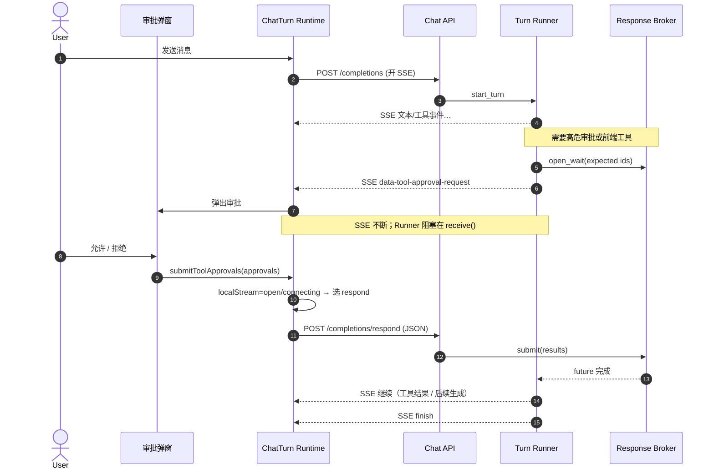
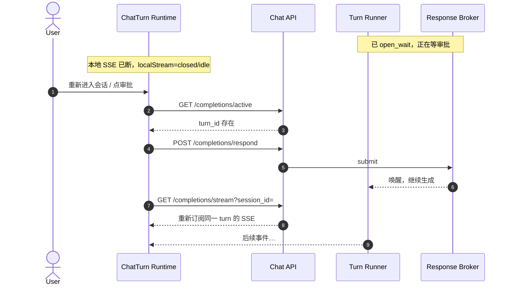
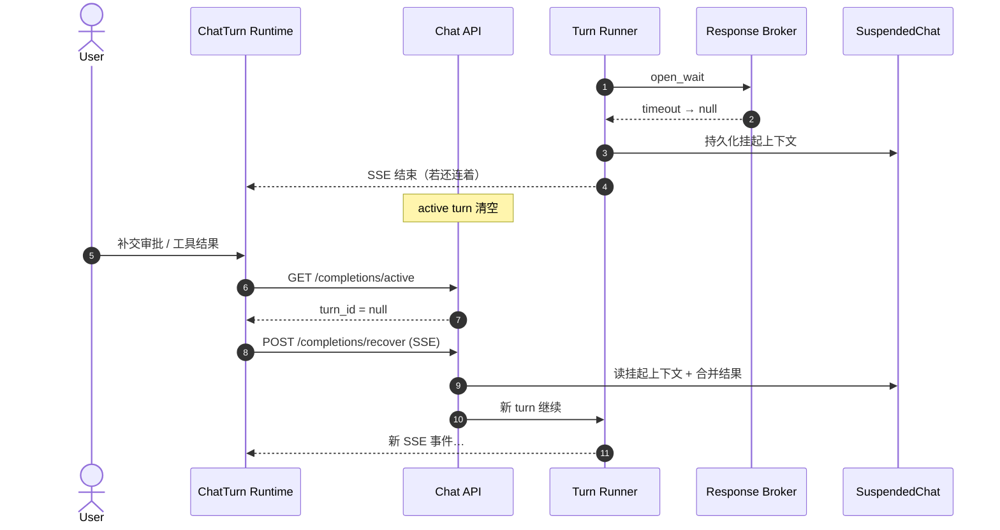
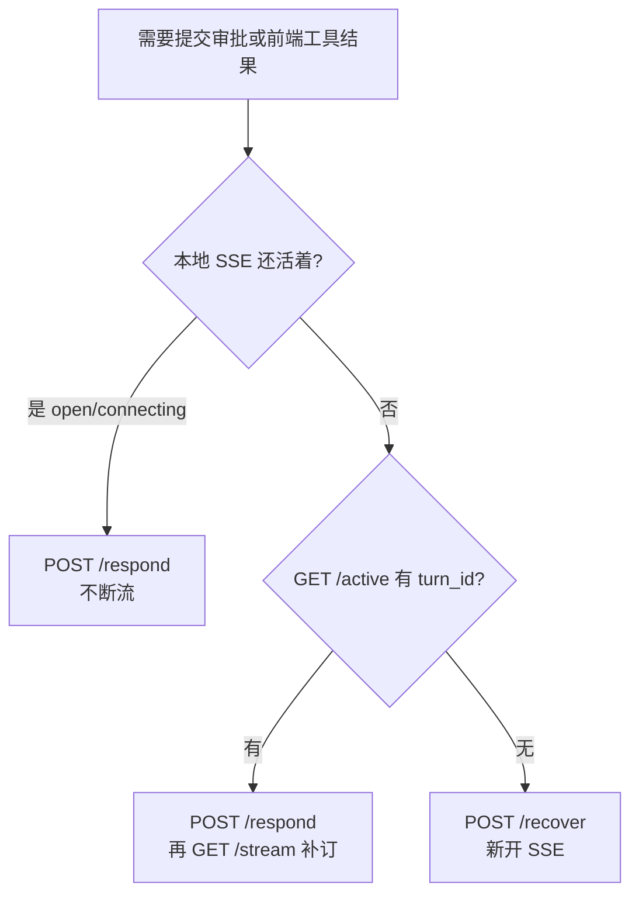

# Chat Turn：respond / recover 时序

> 对应实现：`useChatTurnRuntime.submitToolApprovals`、后端 `POST /chat/completions/respond|recover`  
> 目的：讲清「为什么审批时不能再一律走 recover」。

## 一句话

- **respond**：turn 还在跑、后端在等前端 → JSON 提交结果，**原 SSE 继续**
- **recover**：turn 已挂起（超时等）→ 提交结果并 **新开 SSE**
- **stream**：只订阅已有 turn 的事件，不提交结果

---

## 角色

| 角色 | 是谁 |
|---|---|
| UI | 审批弹窗 / 前端工具执行 |
| Runtime | `useChatTurnRuntime`，组合 Message Pipeline 与领域 Service |
| Chat API | `wisepen-chat-service` |
| Runner | 后端 ReAct 循环（写 Redis Stream） |
| Broker | `FrontendToolResponseBroker`（等前端结果） |

---

## 路径 A：正常审批（当前主路径）

SSE 一直开着；用户点允许/拒绝后只打 respond。

**前端判定**：`localStream === 'open' | 'connecting'` → 直接 respond，不 `sendMessage`。

---

## 路径 B：页面断流，但 turn 还在等

用户刷新、切页、网络抖一下：前端 SSE 没了，后端 runner + broker 还在。

**前端判定**：非 live stream，但 `getActiveTurnId()` 有值 → respond + `resumeLocalStream()`。

---

## 路径 C：等待超时 → 挂起 → recover

Broker 超时后 runner 挂起；此时 **没有** active turn，respond 没用，必须 recover 新开一轮。

**前端判定**：无 active turn → `chat.sendMessage(undefined, { body: recover })` → transport 打到 `/recover`。

---

## 三条 API 对照

| API | 何时 | 响应 | 会不会新开 turn |
|---|---|---|---|
| `POST /completions/respond` | runner 仍在等 Broker | JSON `R.success` | 否 |
| `GET /completions/stream` | 有 active turn，只重连看流 | SSE | 否 |
| `POST /completions/recover` | 无 active turn，从挂起恢复 | SSE | 是（新 turn） |
| `POST /completions` | 用户发新消息 | SSE | 是 |

---

## 和旧协议差在哪

| | 旧 | 现（已接） |
|---|---|---|
| 要审批/前端工具时 | 后端常先结束 SSE，等前端再 recover | SSE 保持；前端 respond |
| 审批弹窗 | 以前前端会挡 `running` 时点击 | 允许 streaming 时提交 |
| recover | 几乎每次续跑都用 | **仅挂起恢复** |

---

## 代码落点

- 路由逻辑：`src/domains/ChatTurn/runtime/useChatTurnRuntime.ts` → `submitToolApprovals`
- JSON 契约：`RespondChatTurnApi` → `/chat/completions/respond`
- 审批触发：`useChatToolApproval` → `submitToolApprovals`
- 后端等待：`FrontendToolResponseBroker`；接口：`chat/api/endpoints/chat.py`
