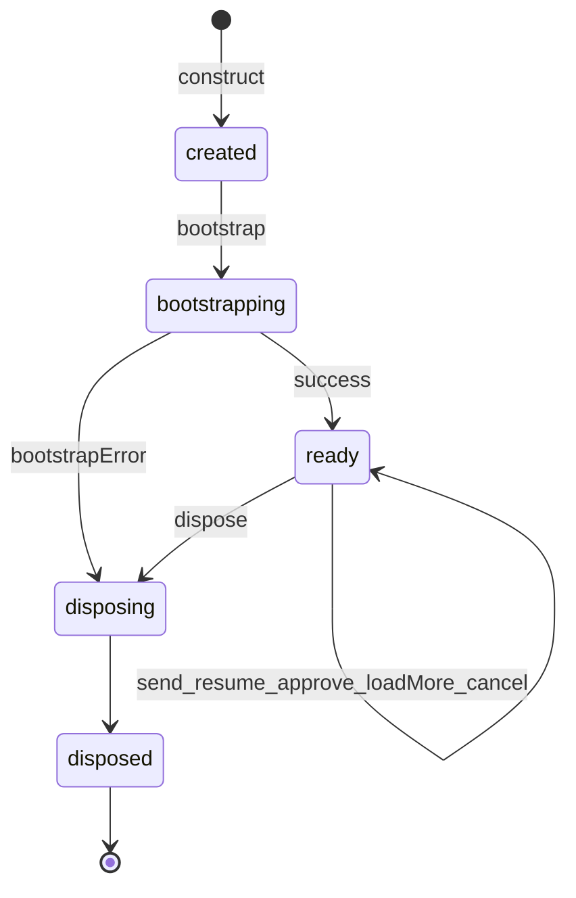
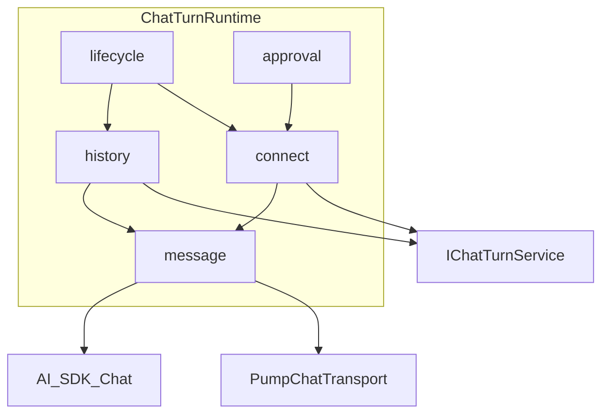

# 阶段 1：单 Runtime

> 目标：交付**与 session 切换无关**的单实例 Runtime。
> 原则：先写脚手架行为测试，再搬迁/改写实现；**实现完成后拆掉测试**。
> 本阶段**不实现 Router**，不接 Chat 组件。
> 已决语义见 [名词表](./00-glossary.md)、[已决](./99-open-questions.md)。

---

## 1. 问题陈述

V1 把「会话内协议」和「sessionId 变化」绑在同一个 hook 树上。阶段 1 验收：**一个 Runtime 实例只服务一个冻结的 `sessionId`**；无改 sessionId API。

协议选路仍以 [respond / recover 时序](../chat-turn-respond-sequence.md) 为准。

---

## 2. 交付物

| 交付物                                                 | 说明                                                     |
| ------------------------------------------------------ | -------------------------------------------------------- |
| 脚手架行为测试                                         | 覆盖 bootstrap → ready → send/续跑 → dispose；完成后删除 |
| `ChatTurnRuntime` + `connect/history/message/approval` | 固定 sessionId 的 class 组合                             |
| 模块架构图 / 生命周期状态机                            | 本文件 §4–§5，与代码枚举一致                             |
| `ChatTurnRuntimePort` + `RuntimeView`                  | 供阶段 2 Fake 对齐                                       |

**非交付：** Router、React 切流、删 V1。

---

## 3. 测试脚手架

- 用 `node:test` + esbuild 打 entry（同现有 `tests/*.test.mjs`）。
- Fake `IChatTurnService` + 可控 SSE body。
- **不做常驻 CI 例外**；阶段 DoD 达成后删除测试文件。

### 场景矩阵（应有行为）

**A. 生命周期**

1. `sessionId` 冻结。
2. `bootstrap({ isNewSession: true })` → 不拉历史、不 resume → `ready`。
3. `bootstrap({ isNewSession: false })` → 历史 replace → 有 active 则 resume。
4. 无 active turn → 跳过 resume，仍 `ready`。
5. bootstrap 失败 → 抛错且实例已 dispose（清理干净）。
6. `dispose` 可重复；之后禁止 `send`。

**B. 发送与取消** — 同 V1：pumpSend；live 时 send no-op；cancel = 停本地 + `cancelTurn`；dispose 不自动 cancel。

**C. 审批续跑** — respond / respond_resume / recover（时序文档）。

**D. 历史** — `loadMore` prepend；历史失败不留脏全量。

**E. 不测** — 多实例互切、Router、React。

---

## 4. 生命周期状态机



| Phase                  | 允许                                         | 禁止           |
| ---------------------- | -------------------------------------------- | -------------- |
| `created`              | `bootstrap`                                  | `send`         |
| `bootstrapping`        | 内部历史/resume                              | 外部 `send`    |
| `ready`                | send / cancel / approve / loadMore / dispose | 改 `sessionId` |
| `disposing`/`disposed` | （dispose 幂等）                             | 业务动作       |

无长期 `failed` 相：失败即 dispose。

Connect phase（`idle/connecting/open/closed`）仍是内部子状态机。

---

## 5. 模块架构



| 模块       | 来源                 | 要点                             |
| ---------- | -------------------- | -------------------------------- |
| `message`  | `runtime/message/*`  | 实例持有 `Chat` + Pump；按次 arm |
| `connect`  | `runtime/connect/*`  | 去掉跨 session stale             |
| `history`  | `runtime/history/*`  | 无 `useEffect(sessionId)`        |
| `approval` | `runtime/approval/*` | 派生 + submit                    |
| lifecycle  | 新                   | bootstrap / dispose              |

依赖：Runtime → Service；不依赖 Router / React。

---

## 6. 端口草案

```ts
interface ChatTurnRuntimePort {
  readonly sessionId: string;
  readonly lifecycle: LifecyclePhase;
  readonly chat: Chat<WisePenUIMessage>;

  bootstrap(options: { isNewSession: boolean }): Promise<void>;
  dispose(): void;

  send(query: string, options?: SendTurnMessageOptions): Promise<void>;
  cancel(): Promise<void>;
  submitToolApprovals(statuses: ToolApprovalStatusRequest[]): Promise<void>;
  loadMore(): Promise<void>;

  getView(): RuntimeView;
  subscribe(listener: () => void): () => void;
}
```

无 `blur`：失焦不停泵，由 Router 只改 active 指针。

---

## 7. 从 V1 复用

搬迁：`pumpChatTransport`、`resolveContinuation`、connect/history/approval 逻辑、`chatTurnModel`。

删除：跨 session `latestSessionId` 防护、history effect teardown、单 hook 多 session 假设。

---

## 8. DoD

- [ ] 场景矩阵脚手架曾全绿，实现稳定后测试已删或标明待删
- [ ] 无 Router/React 生产依赖
- [ ] 架构图/状态机与代码一致
- [ ] lint / typecheck 通过；V1 仍可用
