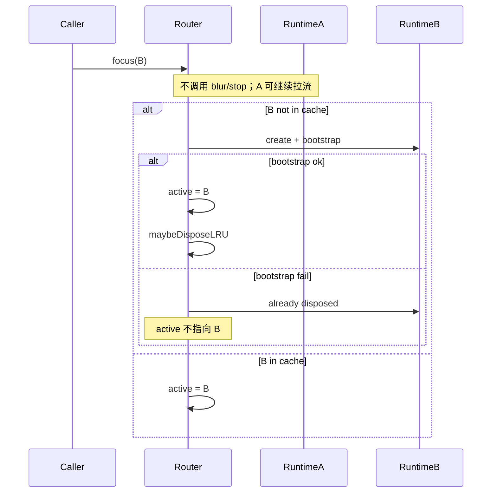

# 阶段 2：Router（假 Runtime）

> 目标：多 session 缓存与唯一 focus；假 Runtime 单测。
> 已决：后台**不停泵**；超限 **dispose**；`MAX_CACHED_RUNTIMES = 5`（可调 3–5）。

---

## 1. 交付物

| 交付物                  | 说明                                                          |
| ----------------------- | ------------------------------------------------------------- |
| Router 脚手架测试       | focus / 缓存命中 / LRU dispose / clear；完成后可拆            |
| `chatTurnRuntimeRouter` | Map + activeSessionId + 工厂注入                              |
| 资源策略                | 最多 5 个 Instance；均可 live SSE；超限 dispose 非 active LRU |

---

## 2. Fake / 端口（与阶段 1 对齐）

```ts
interface RouterRuntimePort {
  readonly sessionId: string;
  bootstrap(options: { isNewSession: boolean }): Promise<void>;
  dispose(): void;
  /** 可选：供策略观测 */
  isStreaming(): boolean;
}
```

无 `blur` / `resumeAfterFocus`：focus 只改指针；缓存命中不 bootstrap、不强制 resume。

---

## 3. 不变量

1. 至多一个 `activeSessionId`（可为 null）。
2. active 非 null ⇒ Map 中有对应 Runtime。
3. 后台 Runtime **可以**继续 streaming。
4. `size(Map) ≤ MAX_CACHED_RUNTIMES`（默认 5，含 active）。
5. 超限：dispose 最久未 focus 的**非 active**。
6. bootstrap 失败：该实例 dispose，不留在 Map；不把半残设为 active。
7. 登出 `registerStore(session)`：全部 dispose + active=null。



---

## 4. 测试矩阵（摘要）

1. focus 新建 → bootstrap → active。
2. 再 focus 同 id → 不重复 create。
3. focus A 再 B → A 仍在 Map 且可仍 streaming；active=B。
4. 回 focus A（缓存命中）→ 不 bootstrap。
5. 超过上限 → 最久非 active 被 dispose。
6. 不可 dispose active。
7. clear → 全 dispose。
8. bootstrap 失败 → 不在 Map、非 active。

---

## 5. DoD

- [ ] 矩阵脚手架曾绿；可按约定拆测试
- [ ] 不依赖真 SSE
- [ ] lint / typecheck；不改 Chat 组件
