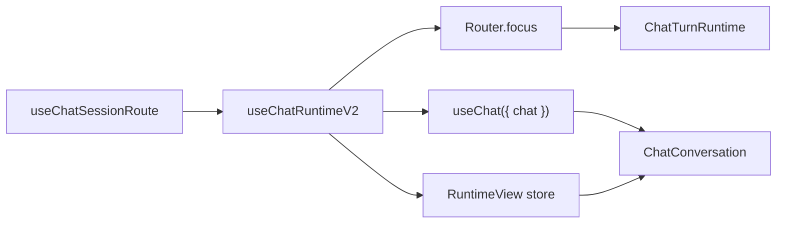

# 阶段 3：整合与组件消费

> 前置：阶段 1/2 完成。真 Runtime 作工厂；`useChatRuntimeV2` 消费 active。
> Send 经 Router/Hook 只打到 focus 实例。

---

## 1. 交付物

| 交付物             | 说明                                                              |
| ------------------ | ----------------------------------------------------------------- |
| 默认工厂           | Router → `ChatTurnRuntime`                                        |
| `useChatRuntimeV2` | focus(route.sessionId) + `useChat({ chat })` + `RuntimeView` 订阅 |
| Chat 切流          | 改导入；壳层仍负责 ensureSession / 门禁                           |
| 文档收口           | BUSINESS.md；稳定后删 V1                                          |

---

## 2. 消费模型

- `sessionId == null` → active=null，UI 空态。
- 新建：ensureSession → route 更新 → `focus(id, { isNewSession: true })` → `send`。
- 切会话：只改 active；旧 Instance 进 background **继续拉流**。
- Pump：**不**随 focus 切换；仅新开 SSE 时 arm。

---

## 3. 验证

静态：lint / typecheck。
运行态：A streaming 切 B 回 A（消息应已在后台增长）；新建；审批三路径；cancel；登出；超限后再进需重新 bootstrap。

脚手架测试不默认保留。

---

## 4. DoD

- [ ] Chat 仅 V2
- [ ] V1 已删或紧随删除
- [ ] BUSINESS 与名词表一致
- [ ] 登出无泄漏
